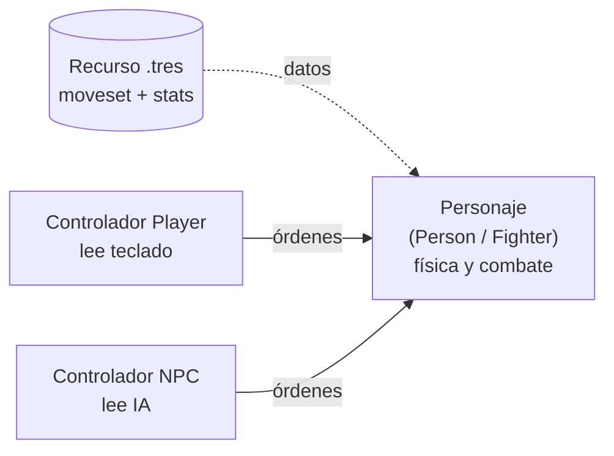

# Nota: Escalabilidad de personajes

> Qué tan fácil es sumar personajes con la arquitectura actual: qué funciona, qué estorba y una propuesta **no implementada**. La jerarquía de clases vive en [arquitectura-personajes.md](arquitectura-personajes.md); el sistema de ataques en [nota-ataques.md](../combate/nota-ataques.md); el hitbox en [hitbox.md](../combate/hitbox.md); los nombres de animación en [asset-personaje.md](../arte/asset-personaje.md).
>
> Rutas cortas: `scripts/characters/` (`person.gd`, `fighter.gd`, `power_fighter.gd`, `player.gd`, `npc.gd`), `scripts/match/spawn_point.gd`, `scripts/helpers/combat/` (`attacks.gd`, `power_attacks.gd`, `fight_move.gd`, `hitbox_move.gd`), `scripts/combat/hitbox_damage.gd`. Líneas verificadas el 2026-10-24.

## Resumen

**Calificación: 6.5/10.** Sólido para un prototipo con un personaje. Incómodo para escalar a un roster: cada personaje con moveset propio exige copiar cientos de líneas, y combinar un moveset propio con el rol de jugador o NPC obliga a duplicar clases.

## Lo que funciona

- **Ataques como datos.** Cada ataque es un diccionario que `FightMove` y `HitboxMove` mezclan sobre sus valores por defecto (`fight_move.gd`, `hitbox_move.gd`). *Por qué:* para balancear (daño, duración, tamaño de hitbox) se cambian números, no la lógica de `fighter.gd:511` (`_fight_move()`).
- **Capas con hooks vacíos.** `Person` define `_collect_input` (`person.gd:202`), `_process_action` (`person.gd:1068`), `_cancel_action` (`person.gd:1074`) y `_process_ai` (`person.gd:1086`) como `pass`. `Fighter` sobrescribe `_process_action` (`fighter.gd:878`) y `_cancel_action` (`fighter.gd:941`). *Por qué:* cada capa agrega lo suyo sin tocar la física base.
- **Cerebro separado de habilidades.** Quién decide la acción está aparte de lo que el personaje puede hacer: `Player` lee teclado (`player.gd:24`) y `NPC` usa IA (`npc.gd:270`, `npc.gd:305`). Ambos escriben los mismos bools (`_move_left`, `_attack`...) que el combate consume.
- **Un solo tipo de hitbox.** `HitboxDamage` sirve para golpe pegado al cuerpo (hijo del `Pivot`, `fighter.gd:350-352`) y para proyectil (`use_gravity`, nodo libre de la escena, `fighter.gd:353-358`). *Por qué:* la diferencia es un flag; no hay dos clases que mantener.

## Problemas

### 1. Moveset dentro del script

- `fighter.gd:48` define 15 `FightMove` (líneas 48-292) y `power_fighter.gd:8` define 6 (líneas 8-131). No hay movesets en `.tres`: el proyecto solo tiene `.tres` de entorno y materiales.
- Hay duplicación en `power_fighter.gd`: `down`/`air_down`, `standard`/`air_standard` y `up`/`air_up` tienen los mismos hitboxes y solo difieren en `name` y en flags de aire (`air_attack`, `override_horizontal_move`).
- *Efecto:* un personaje nuevo con moveset propio son unas 370 líneas que copiar y ajustar. *Por qué pesa:* un ajuste de balance hay que replicarlo a mano en cada par.

### 2. Slots fijos

- `Attacks` tiene 15 campos y su `_init` pide los 15 en orden (`attacks.gd:23`). `PowerAttacks` tiene 6 claves fijas (`power_attacks.gd:15-21`, lectura en `power_attacks.gd:30-35`).
- *Efecto:* un personaje con 3 ataques, o con un especial extra, exige tocar la clase base. `PowerAttacks` ignora en silencio las claves que no conoce: un `"special"` no da error, simplemente no se usa.
- *Por qué existen así:* `_init_attack_by_move()` (`fighter.gd:408`) elige el ataque por nombre de slot (`_attacks.heavy_side`, etc.). Cambiar el conjunto de slots obliga a cambiar también ese selector.

### 3. Doble salto y poderes atados a `PowerFighter`

- `power_fighter.gd:157` (`_max_jumps = 2`, dentro de `_init()`) y el catálogo `_power_attacks` viven en la misma clase. Mezclan dos cosas distintas: "puede lanzar poderes" y "tiene doble salto". Un personaje con poderes y salto simple (o al revés) no puede tomar solo una de las dos sin heredar la otra.
- *Verificado:* `set_script()` sí ejecuta el `_init()` del script nuevo (probado en Godot 4.7.2 con un proyecto de prueba aislado, nodo plano + `set_script`). Por eso el `_max_jumps = 2` sí aplica a `Player` y `NPC` aunque el prefab no tenga script. No es un bug, pero depende de ese comportamiento.

### 4. `Player`/`NPC` al final de la herencia (problema principal)

- `player.gd:2` y `npc.gd:2` heredan de `PowerFighter`. GDScript tiene herencia única: un personaje con script propio (`extends PowerFighter`, por ejemplo) no puede además ser `Player` ni `NPC`.
- `SpawnPoint.spawn()` (`spawn_point.gd:12`) instancia un prefab genérico (`standard_power_fighter.tscn`, raíz `CharacterBody3D` sin script) y le pone el script con `set_script` (`spawn_point.gd:23` y `spawn_point.gd:28`).
- *Lo que se gana:* un solo prefab sirve para jugador y NPC.
- *Lo que cuesta:* para un personaje con script propio habría que crear `PlayerX extends X` y `NPCX extends X`, copiando la lógica de `player.gd` y `npc.gd`. Con N personajes son 2N clases de rol. Además, el `match` de `spawn()` solo cubre `PLAYER` y `NPC` (`scripts/helpers/global_utils.gd:5`), así que cualquier otro rol no recibe script.

### 5. Los datos solo cubren golpes

- Hoy los datos cubren golpes, saltos de ataque (`jump_power`, usado por `up` y `air_up` de `PowerFighter`) y proyectiles con gravedad y rebote (`use_gravity`, `bounce`, `fighter.gd:350-358`).
- Mecánicas como teletransporte, contraataque o carga no tienen campo en el dato: requieren código nuevo en `Fighter` o en una subclase.

### 6. Animaciones atadas por nombre

- `_attack_anim()` (`fighter.gd:603-607`) reproduce `_current_attack.name` en el `AnimationPlayer`. El nombre del `FightMove` **es** el nombre de la animación.
- Un modelo nuevo debe traer esos nombres exactos (lista en [asset-personaje.md](../arte/asset-personaje.md), sección Animaciones). Si falta uno, ese doc advierte que puede romperse.
- *Efecto:* es una ventaja para variantes (cambiar de modelo no toca código) y un límite para personajes con animaciones distintas.

## Dificultad hoy

| Caso | Dificultad | Por qué |
|---|---|---|
| Variante: mismo rig, otro modelo y/o números | Fácil/medio | Con el mismo moveset basta el modelo con los nombres exactos. Con números propios hace falta una subclase, y ahí choca el problema 4: hoy todos comparten el catálogo de la clase base |
| Personaje realmente distinto (moveset, poderes, mecánicas) | Medio/difícil | Copiar o reescribir ~370 líneas, slots fijos, `PlayerX`/`NPCX`, mecánicas nuevas en `Fighter` |

## Propuesta (NO implementada)

> Idea para discutir. Nada de esto existe en el código.

1. **Moveset como `Resource` (`.tres`)**: un recurso con un diccionario de ataques (`nombre → config de FightMove`). *Por qué:* el catálogo sale del código y cada personaje tiene el suyo. La selección de `_init_attack_by_move()` pediría claves en vez de campos fijos, lo que resuelve el problema 2.
2. **Player/NPC como controladores por composición**: un nodo hijo que lee teclado o IA y manda órdenes al personaje (`move_left`, `attack`...). *Por qué:* el personaje queda como una sola clase y el rol deja de ser herencia. Elimina `PlayerX`/`NPCX` (problema 4).
3. **Stats en el mismo recurso**: saltos máximos, velocidades, etc. *Por qué:* `_max_jumps` deja de depender de `PowerFighter` (problema 3).

**Resultado esperado:** personaje nuevo = un `.tres` + modelo con animaciones.

**Preguntas abiertas** (decisión del equipo antes de avanzar):
- ¿El controlador es un nodo hijo, como se propone aquí, o se queda como script de rol?
- ¿Los stats van en el mismo `.tres` que el moveset o en otro recurso?
- ¿Las mecánicas especiales (teletransporte, contraataque) se modelan como datos o como subclases de `Fighter`?

## Ver también

- [arquitectura-personajes.md](arquitectura-personajes.md): jerarquía `Person` → `Fighter` → `PowerFighter`.
- [nota-ataques.md](../combate/nota-ataques.md): cómo se elige y ejecuta un ataque.
- [hitbox.md](../combate/hitbox.md): construcción y ciclo de vida del hitbox.
- [asset-personaje.md](../arte/asset-personaje.md): nombres de animación fijos.
