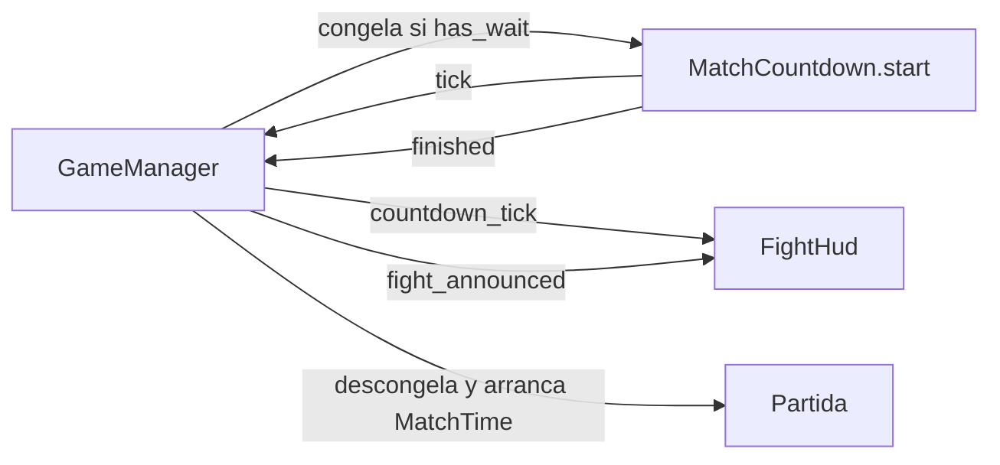

# Nota: MatchCountdown — cuenta regresiva previa a la pelea

> Implementado en `scripts/match/match_countdown.gd` como nodo hijo del mapa.
> Verificado el 2026-11-11.

## Responsabilidad

`MatchCountdown` es un módulo `Node` que **solo** cuenta los segundos previos a la pelea. No
congela peleadores, no muestra el letrero de ¡PELEA!, no conoce vidas ni decide el fin de la
partida. `GameManager` es quien usa esa cuenta para arrancar la partida.

Separación de responsabilidades:

- `MatchCountdown`: cuánto falta para empezar y avisar cuando terminó la cuenta.
- `GameManager`: congelar durante la espera, mostrar el letrero y arrancar el reloj.
- `FightHud`: pintar el número que recibe y el letrero cuando el manager se lo pide.

## API

- `@export_range(0, 9, 1) countdown_seconds: int = 3`: duración de la cuenta. `0` pasa directo.
- `has_wait() -> bool`: dice si hay algo que esperar (`countdown_seconds > 0`).
- `start()`: reinicia la cuenta y, si hay segundos, emite el primer `tick`. Si ya estaba corriendo,
  no hace nada.
- `stop()`: detiene la cuenta sin emitir `finished`.
- Señales:
  - `tick(seconds_left: int)`: segundos que faltan. Se emite al arrancar y cada vez que cambia el
    segundo entero.
  - `finished`: se emite una sola vez cuando la cuenta llega a cero, o de inmediato si
    `countdown_seconds == 0`.

La cuenta usa `_process(delta)`, no `_physics_process`, porque no depende de colisiones ni de un
`delta` fijo de física. El último `tick` no es `0`: la señal `finished` es la que avisa que terminó.

## Flujo con `GameManager`

El `GameManager` decide si congela a los peleadores antes de llamar `start()`. Si la cuenta es `0`,
no hay congelamiento por cuenta. El letrero de ¡PELEA! y su duración viven en
`GameManager.fight_sign_seconds`; `MatchCountdown` no los conoce.

## Integración

- `MatchCountdown` vive como nodo hijo del mapa (`MatchCountdown` en `map1.tscn`), igual que
  `MatchTime` y `LivesManager`.
- `GameManager` lo toma con `$MatchCountdown` y conecta `tick` y `finished` en `_ready()`.
- `GameManager._start_countdown()` lo arranca después de spawnear a los peleadores.
- `GameManager._on_countdown_tick()` reemite `countdown_tick` para el HUD.
- `GameManager._on_countdown_finished()` muestra el letrero si hay `fight_sign_seconds`, descongela,
  arranca `MatchTime` y emite `match_started`.
- Si `start()` se llama dos veces, la segunda se ignora para no reiniciar la cuenta a media pelea.
- `stop()` no emite `finished`: cancelar una cuenta no es lo mismo que terminarla.

## Lo que no hace

- No congela peleadores; eso lo hace `GameManager` con `process_mode`.
- No muestra el letrero de ¡PELEA!; solo avisa que la cuenta terminó.
- No cuenta el tiempo límite de la partida; eso es `MatchTime`.
- No decide si la partida puede empezar; el manager orquesta la secuencia.

## Ver también

- [nota-match-time.md](nota-match-time.md): reloj de la partida y fin por tiempo.
- [nota-game-manager-modular.md](nota-game-manager-modular.md): módulos de la partida y
  responsabilidades.
- [nota-process-vs-physics-process.md](nota-process-vs-physics-process.md): por qué este temporizador
  usa `_process`.
