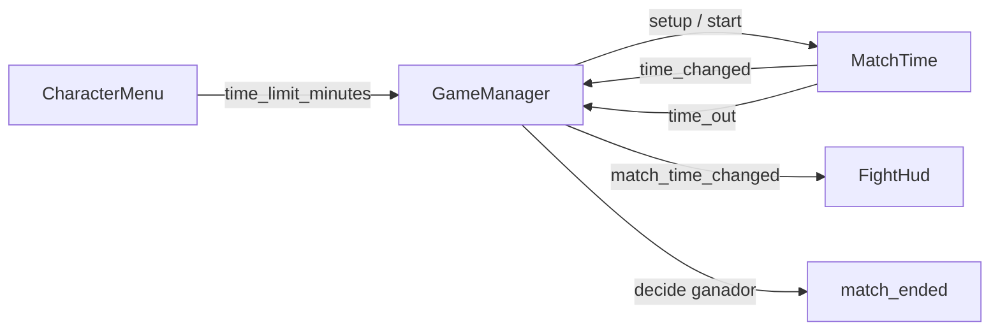

# Nota: MatchTime — tiempo límite de la partida

> Idea **no implementada**. Reemplaza el nombre `MatchClock` que aparecía en notas anteriores.
> Verificado el 2026-11-10.

## Problema

`GameManager` solo lleva el tiempo transcurrido (`_match_time`, `scripts/match/game_manager.gd:42`) y
el HUD lo pinta en `mm:ss` (`scripts/ui/fight_hud.gd:318`). `CharacterMenu` ya tiene
`TIME_OPTIONS` y `time_index` (`scripts/ui/character_menu.gd:29` y `:54`), pero `_start_match()` no
los pasa a la partida: la línea quedó comentada (`character_menu.gd:331`). No existe fin por tiempo ni
cuenta regresiva de partida.

`countdown_seconds` (`game_manager.gd:33`) no es el tiempo límite: es el 3-2-1 previo a la pelea.

## Responsabilidad

`MatchTime` es un módulo `Node` que **solo** cuenta el tiempo límite. No conoce vidas, daño ni
ganador. `GameManager` lo configura, lo arranca, escucha su señal y decide el ganador cuando recibe
`time_out`.

Separación de responsabilidades:

- `MatchTime`: cuánto falta, avisar cuando se acabó.
- `GameManager`: cuándo arranca, cuándo se detiene y quién gana.
- `FightHud`: solo pinta el número que recibe.
- `LivesManager`: sigue siendo la fuente de las vidas restantes.

## API propuesta

- `setup(minutes: int)`: `0` = sin límite.
- `start()` / `stop()`.
- `get_time_left_seconds() -> int`.
- Señales: `time_changed(seconds_left: int)` y `time_out`.
- `_physics_process()`: descuenta `delta`, emite el segundo entero con `ceili()` y al llegar a `0`
  emite `time_out` una sola vez.

Si `minutes == 0`, `MatchTime` no hace nada: `GameManager` conserva el cronómetro actual que cuenta
hacia arriba.

## Flujo propuesto

## Integración

- `GameManager` expone `time_limit_minutes` como propiedad de partida.
- `CharacterMenu` hace `level.time_limit_minutes = TIME_OPTIONS[time_index]` antes de
  `change_scene_to_node`.
- `MatchTime` vive como nodo hijo del mapa, igual que `LivesManager` en `map1.tscn`, o como
  propiedad instanciada por `GameManager`. Recomendado: nodo hijo para poder ajustarlo desde el
  inspector.
- `_run_countdown()` arranca `MatchTime` justo cuando `_match_running = true`
  (`game_manager.gd:126`).
- `_end_match()` detiene `MatchTime` (`game_manager.gd:129`).
- Si hay límite, `match_time_changed` emite segundos **restantes**; si no hay límite, sigue emitiendo
  segundos **transcurridos** como hoy.
- El HUD no necesita lógica nueva: ya formatea `mm:ss`.
- Durante la cuenta inicial se puede mostrar el límite completo, por ejemplo `03:00`.

## Fin de partida

Cuando `MatchTime` emite `time_out`, `GameManager` decide:

1. Gana quien tenga **más vidas restantes**.
2. Si empatan en vidas, gana quien tenga **menor `damage_percentage`**
   (`scripts/characters/person.gd:32`).
3. Si siguen empatados, `match_ended(null)` (empate).

Para las vidas hace falta un getter público en `LivesManager`, por ejemplo
`get_lives(power_fighter) -> int`. Hoy `_lives` es privado (`scripts/match/lives_manager.gd:20`).

## Pendientes

- Conectar `TIME_OPTIONS` con `GameManager.time_limit_minutes`.
- Agregar `LivesManager.get_lives()`.
- Definir si `MatchTime` será nodo hijo o propiedad instanciada.
- No incluye sudden death ni reglas extra de desempate.
- `MatchCountdown` sigue siendo otro módulo: el 3-2-1 previo a la pelea no es `MatchTime`.
- Si la partida se abre directo desde `map1.tscn`, no hay límite de tiempo ni peleadores, porque
  `PowerFighterSlots` está vacío.

## Ver también

- [nota-game-manager-modular.md](nota-game-manager-modular.md): módulos de la partida y
  responsabilidades.
- [nota-power-fighter-configurer.md](nota-power-fighter-configurer.md): cómo se llena el lineup por
  slot antes de cambiar de escena.
