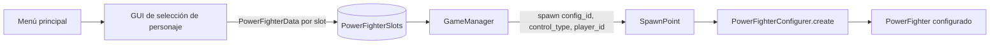

# Nota: Configuración de Power Fighter (PowerFighterConfigurer)

> Cómo se separa el "quién controla" del "qué personaje es", qué hace `PowerFighterConfigurer`,
> cómo lo usa `SpawnPoint` y cómo debería el `GameManager` repartir las configuraciones.
> Verificado el 2026-11-07; actualizado el 2026-11-21. Rutas: `scripts/helpers/global_utils.gd`,
> `scripts/helpers/match/power_fighter_data.gd`, `scripts/helpers/characters/character_registry.gd`,
> `scripts/helpers/ui/character_catalog.gd`, `data/power_fighters/identities.cfg`,
> `scripts/match/power_fighter_slots.gd`, `scripts/match/power_fighter_configurer.gd`,
> `scripts/helpers/characters/person_config.gd`, `scripts/match/spawn_point.gd`, `scripts/match/game_manager.gd`,
> `scripts/match/match_time.gd`, `scripts/match/match_countdown.gd`,
> `scripts/ui/character_menu.gd`, `scripts/ui/fight_hud.gd`,
> `scripts/ui/components/character_menu/slot_card.gd`,
> `scripts/characters/person.gd`, `scripts/characters/fighter.gd`,
> `scripts/characters/power_fighter.gd`, `scripts/helpers/combat/attacks.gd`,
> `scripts/helpers/combat/power_attacks.gd`, `scripts/helpers/combat/fight_move.gd`.

## Resumen

La configuración de un peleador se parte en dos conceptos independientes:

- **`ControlType`**: quién lo controla (`PLAYER` o `NPC`). No dice nada del modelo ni de sus stats.
- **`config_id: StringName`**: qué personaje es (`&"standard"`, `&"tux"`, ...). No dice nada de quién lo controla.

Con eso, cualquier combinación es válida: un `PLAYER` con Tux, un `NPC` con Standard, etc.
`PowerFighterConfigurer` es la clase que materializa esa combinación: crea el `PowerFighter`
desde el prefab base y le aplica el modelo, los datos y el controller según el `config_id` y el
`ControlType`.

El `config_id` ya no es un enum: lo emite `CharacterRegistry` desde
`data/power_fighters/identities.cfg` y lo consume `CharacterCatalog` en la selección.

---

## 1. `CharacterType` → `ControlType` + `config_id`

### Antes

`GlobalUtils` tenía un solo enum:

```gdscript
enum CharacterType { PLAYER, NPC }
```

Ese enum mezclaba dos decisiones distintas. Un `CharacterType.PLAYER` no solo decía "lo controla
el jugador", también arrastraba la idea de que el modelo era el único que existía. Agregar un
personaje nuevo (Tux) habría obligado a inventar valores como `PLAYER_TUX` o `NPC_TUX`,
multiplicando combinaciones y rompiendo el `match` de `SpawnPoint`.

Después vinieron dos enums (`ControlType` y `PowerFighterConfig`). Eso ya separaba rol de identidad,
pero seguía mal para escalar: cada personaje nuevo exigía tocar el enum y el `match` del configurador.

### Ahora

`scripts/helpers/global_utils.gd` conserva solo el enum de control:

```gdscript
enum ControlType { PLAYER, NPC, NONE }
```

La identidad sale de tres piezas:

| Pieza | Archivo | Qué hace |
|---|---|---|
| `identities.cfg` | `data/power_fighters/identities.cfg` | Manifiesto global: cada sección es un id `snake_case` y `name` es el texto visible. `standard` no aparece: está hardcoded en el registry. |
| `CharacterRegistry` | `scripts/helpers/characters/character_registry.gd` | Lee el manifiesto, valida ids, expone `playable_ids()` / `display_name()` y resuelve rutas `.person.cfg`. |
| `CharacterCatalog` | `scripts/helpers/ui/character_catalog.gd` | Ordena el roster para la UI. `Entry` trae `config_id`, `display_name`, `glyph`, `is_random` y `model`. |

`standard` es especial: siempre existe y no tiene cfg. Los demás ids deben estar en `identities.cfg`
y tener su `.person.cfg`. El catálogo también arma una entrada de selección aleatoria que es
solo de UI: se resuelve en `CharacterMenu` antes de llenar `PowerFighterData`, así que el
configurador nunca recibe un id no jugable.

### Por qué importa

- **Combinaciones libres**: `PLAYER + tux` y `NPC + standard` funcionan sin tocar enums ni duplicar clases.
- **Crecimiento limpio**: agregar personaje es una sección en `identities.cfg` + su `.person.cfg`
  (y su `.fighter.cfg` cuando el configurer lo cargue). No se toca `ControlType` ni un enum.
- **Nombre visible separado**: `display_name` sale del registry; el `config_id` técnico queda estable.
- **Responsabilidad clara**: el rol de control y la identidad del personaje se deciden por separado.

---

## 2. `PowerFighterConfigurer`

Vive en `scripts/match/power_fighter_configurer.gd`. Es una clase utilitaria (no es un nodo) con
métodos estáticos. Concentra el "cómo se arma un peleador de una config".

### `create(config_id, control_type)`

```gdscript
static func create(
	config_id: StringName, control_type: GlobalUtils.ControlType
) -> PowerFighter:
```

Flujo real, en orden:

1. Instancia el prefab base `res://prefabs/standard_power_fighter.tscn`.
2. Si `config_id` es jugable y no es `standard`, resuelve su `.person.cfg` con
   `CharacterRegistry.person_config_path()` y lo carga con `_load_person()`; luego llama a
   `_build_instance()` para cambiar el modelo visual.
   - `standard`: no hace nada, se queda el modelo que trae el prefab.
3. Asigna el **controller** según el control con un `match`:
   - `ControlType.PLAYER`: `power_fighter.controller = PlayerController.new()`.
   - `ControlType.NPC`: `power_fighter.controller = NpcController.new()`.
   - `ControlType.NONE`: `pass`.
4. Si hay config de persona, llama a `_apply_tux_config()` (nombre viejo, **FALTA** renombrar) para
   aplicar datos (id, duraciones, momentum, movimiento, saltos, intervals y, por ahora, ataques
   hardcodeados).
5. Retorna el `PowerFighter` ya configurado.

> **Deuda de identidad**: hoy `power_fighter.id` se toma de `person_config.id`, que todavía se lee
> del `[identity]` del `.cfg`. La decisión es que el id canónico sea el `config_id`; cuando se
> implemente, `_apply_tux_config()` dejará de depender de `PersonConfig.id`. Hoy funciona porque
> ambos valores coinciden (`&"tux"`).

> Antes se usaba `set_script()` (que borraba los `@export` del prefab); hoy el rol es un nodo hijo y el
> prefab lleva `script = power_fighter.gd`. Ver [nota-power-fighter-controller.md](nota-power-fighter-controller.md).
> `_build_instance()` corre antes de asignar el controller para que el modelo ya esté listo;
> `_apply_tux_config()` corre después para llamar setters del personaje. `_ready()` corre hasta el
> `add_child()` que hace `GameManager`, con todo ya aplicado.

### Config de persona desde archivo `.cfg`

`create()` ya no toma el modelo de una constante: para un `config_id` no-standard resuelve la ruta
con `CharacterRegistry.person_config_path()` (por ejemplo
`res://data/power_fighters/tux.person.cfg`), lee el `.cfg` con `ConfigFile` y obtiene un
`PersonConfig`. `CharacterCatalog` usa el mismo loader del registry para sacar el `model` del
preview de selección. Hoy hay dos loaders con el mismo esquema (`PowerFighterConfigurer._load_person()`
y `CharacterRegistry.load_person_config()`); unificarlos es deuda pendiente.

`scripts/helpers/characters/person_config.gd`:

```gdscript
class_name PersonConfig
extends RefCounted

# Identity
var id: StringName
var character_name: StringName
var model: String
var position_offset: Vector3

# Momentum
var ground_acceleration: float
var ground_friction: float
var air_acceleration: float
var knockback_friction: float

# Horizontal movement
var walking_speed: int
var running_speed: int

# Vartical movement
var jump_impulse: int

# Intervals
var walk_step_interval: float
var run_step_interval: float
var crouch_move_step_interval: float

# Duration of anims
var air_jump_duration: float
```

El prefab sigue siendo `res://prefabs/standard_power_fighter.tscn`. Lo que sale del cfg es el
modelo (`load(config.model)`), el offset de la malla (`mesh.position = config.position_offset`)
y datos de persona: id, momentum, movimiento, salto, intervals y duración de anims. `character_name`
sigue declarado en `PersonConfig` pero ya no se lee del cfg: deuda pendiente de borrar. Las
plantillas base viven en `data/templates/`: `name.person.cfg`, `name.fighter.cfg` y
`name.power_fighter.cfg`.

Ejemplo (`data/power_fighters/tux.person.cfg`):

```ini
[identity]
id = "tux"
model = "res://assets/models/tux/tux_fighter.glb" ; Ruta `res://assets/models/<id>/<modelo>.glb`. Remplaza malla del `prefab`
position_offset = Vector3(0.0,-1.2,0.0)

[momentum]
ground_acceleration = 30.0
ground_friction = 50.0
air_acceleration = 20.0
knockback_friction = 20.0

[horizontal_movement]
walking_speed = 3
running_speed = 8

[vertical_movement]
jump_impulse = 10

[interval]
walk_step_interval = 0.35
run_step_interval = 0.25
crouch_move_step_interval = 0.32

[duration_of_anims]
air_jump_duration = 0.5
```

`ConfigFile` es formato INI: secciones y keys sin espacios, `load()`/`save()` y comentarios con `;`
(que se pierden al guardar). Referencia:
[class_configfile](https://docs.godotengine.org/en/4.7/classes/class_configfile.html).

> **Sin validación**: si falta el cfg o una key, revienta a propósito ("No validar nada, el crash es
> bueno. Data mala, crash por mal educado. GG."). Es la decisión actual del código, no un descuido.

`Person` guarda solo `id` (`person.gd:18`): es la identidad técnica. El texto visible ya no vive en
el `.person.cfg`: sale de `data/power_fighters/identities.cfg` vía `CharacterRegistry.display_name()`
y `CharacterCatalog`. `FightHUD` resuelve el nombre con
`CharacterCatalog.get_entry_by_config_id(power_fighter.id)` (`fight_hud.gd:268`), así que dejó de
mostrar el id crudo. `PersonConfig.character_name` queda como campo muerto por limpiar.

> `data/templates/name.person.cfg` ya usa secciones válidas (`[horizontal_movement]`,
> `[vertical_movement]` y `[interval]`); es la base para copiar configs nuevas.

### `_build_instance()`

Reemplaza el modelo visual del prefab por el que dice la config de persona:

```gdscript
static func _build_instance(power_fighter: Node3D, config: PersonConfig) -> void:
	var visual = power_fighter.get_child(0)
	var asset = visual.get_child(0)

	var loaded_model = load(config.model)
	var new_asset = loaded_model.instantiate()
	var pivot = new_asset.get_child(0)
	var skeleton = pivot.get_child(0)
	var mesh = skeleton.get_child(0)
	mesh.position = config.position_offset

	visual.add_child(new_asset)
	visual.move_child(new_asset, 0)

	visual.remove_child(asset)
	asset.queue_free()
```

- El hijo `0` de la raíz es `Visual`; el hijo `0` de `Visual` es el modelo importado actual.
- El nuevo modelo se agrega y se mueve al índice `0` para conservar el contrato que espera
  `Person._ready()` (el modelo es el primer hijo de `Visual`, `ShieldMeshInstance3D` queda aparte).
- `mesh.position = config.position_offset` reemplaza el viejo `mesh.position.y = -1.2` quemado en
  el código: la calibración visual ahora vive en el cfg (`Vector3(0.0,-1.2,0.0)` para Tux).
- El modelo viejo se saca de `Visual` y se libera.

### `_apply_tux_config()`

Firma actual:

```gdscript
static func _apply_tux_config(
	power_fighter: PowerFighter, person_config: PersonConfig) -> void:
```

Aplica la configuración de datos de Tux. Hoy hace dos bloques:

1. **Datos desde `PersonConfig`**:
   - **Identidad**: hoy `power_fighter.id = person_config.id`. **FALTA**: usar el `config_id` recibido
     en `create()` como fuente canónica; así se puede borrar `id` del `.person.cfg` y el campo
     `character_name` de `PersonConfig`. `Person` guarda solo ese `id`.
   - **Anim/momentum**: `set_duration_of_anims(person_config.air_jump_duration)` y `set_momentum(person_config.ground_acceleration, person_config.ground_friction, person_config.air_acceleration, person_config.knockback_friction)`.
   - **Movimiento**: `jump_impulse`, `walking_speed`, `running_speed`.
   - **Intervals**: `walk_step_interval`, `run_step_interval`, `crouch_move_step_interval`.
2. **Ataques hardcodeados (FALTA pasar a cfg)**:
   - `attacks.neutral1/2/3`, `dash`, `up/down`, `heavy_side/up/down`, `air_neutral/forward/back/up`.
   - `power_attacks.standard/up/down/air_standard/air_up/air_down`.
   - Se ajustan tiempos, speed, jump_power, hitboxes y variantes multigolpe (por ejemplo `heavy_down`, `power_attacks.up/air_up`, `power_attacks.down/air_down`).

> **FALTA**: los ataques siguen hardcodeados en `_apply_tux_config()`. Existen
> `data/templates/name.fighter.cfg` y `data/templates/name.power_fighter.cfg`, pero **no se cargan**
> todavía. Cuando se implemente, esos datos deberían salir de cfg y no del código.

### Contrato de nodos del modelo

`Person._ready()` ya no busca nombres (`"Pivot"`), ahora resuelve por posición
(`scripts/characters/person.gd:944-948`):

```gdscript
var model_root: Node3D = _visual.get_child(0)
_pivot = model_root.get_child(0)            # Pivot
_skeleton3d = _pivot.get_child(0)           # Pivot/Skeleton3D
_mesh_instance = _skeleton3d.get_child(0)   # Pivot/Skeleton3D/MeshInstance3D
_animation_player = model_root.get_node("AnimationPlayer")
```

Por eso todo `.glb` de personaje debe respetar este orden, sin importar los nombres:
`Pivot` → `Skeleton3D` → `MeshInstance3D`, con el `AnimationPlayer` como hijo del modelo. Está
documentado en [asset-personaje.md](../arte/asset-personaje.md). `_build_instance` depende de ese
mismo orden (`new_asset.get_child(0).get_child(0).get_child(0)`).

### Cómo lo usa `SpawnPoint`

`SpawnPoint.spawn()` quedó delgado: ya no preloadea el prefab, los scripts ni los assets. Solo
delega la creación al configurador y remata detalles de spawn:

```gdscript
func spawn(
	config_id: StringName,
	control_type: GlobalUtils.ControlType,
	player_id: int
) -> PowerFighter:
	var power_fighter :PowerFighter = PowerFighterConfigurer.create(config_id, control_type)

	match control_type:
		GlobalUtils.ControlType.PLAYER:
			power_fighter.player_id = player_id

	power_fighter.init_looking_at_right = init_looking_at_right
	power_fighter.position = global_position
	return power_fighter
```

Responsabilidades resultantes:

- `PowerFighterConfigurer`: **qué** es (modelo + script de control).
- `SpawnPoint`: **dónde** aparece (posición del marcador), orientación inicial y `player_id`.

### Material: estado actual

`Person._set_material()` está temporalmente desactivado (`scripts/characters/person.gd:187`):

```gdscript
pass #_mesh_instance.material_override = p_meterial
```

Consecuencia: se conserva el material que trae el `.glb` (la textura de Tux), y el color por slot
que asigna `GameManager` queda ignorado. Es la decisión actual para poder ver Tux con su textura.
Reactivar el `material_override` volvería a pintar al peleador de un color sólido y taparía la
textura.

### Configuración fina de movimientos

`Fighter` expone su catálogo de ataques como `attacks` (`Attacks`, 15 `FightMove`) y `PowerFighter`
expone `power_attacks` (`PowerAttacks`, 6 `FightMove`). Ambos son **públicos**: el configurador
puede entrar directo a cada slot y ajustar sus valores.

`FightMove.name` quedó como **solo lectura** (`scripts/helpers/combat/fight_move.gd:27-30`):

```gdscript
var _name: StringName
var name: StringName:
	get:
		return _name
```

El nombre se fija al construir el `FightMove` y ya no se puede reasignar desde fuera. Los demás
campos (`duration`, `speed`, `direction`, `jump_power`, `hitboxes_moves`, etc.) siguen públicos.
Eso permite cambiar números sin romper el nombre de animación, que es el clip que `_attack_anim()`
reproduce (`scripts/characters/fighter.gd:595`).

Ejemplo de uso desde el configurador:

```gdscript
var move := power_fighter.power_attacks.standard
move.duration = 0.4
move.hitboxes_moves[0].damage = 12
# move.name = &"otra_cosa"  -> error: la propiedad es de solo lectura
```

#### Límites actuales

- `attacks` y `power_attacks` son contenedores públicos, así que todavía se puede reemplazar un slot
  completo por otro `FightMove` (con el nombre que traiga) o por `null`. La protección del nombre
  aplica solo si se muta el `FightMove` existente.
- Si se quisiera blindar también el reemplazo de slots, harían falta setters por slot con validación
  o slots de solo lectura. No es el caso hoy.

#### Combo neutral

`_neutral_combo_attacks` se llena en `_ready()` (`scripts/characters/fighter.gd:861`) con las
referencias de `attacks.neutral1/2/3`. Mutar esos `FightMove` en sitio es seguro: el combo apunta a
los mismos objetos. Si algún día se reemplaza un `FightMove` del combo después de `_ready()`, habría
que refrescar el arreglo.

#### Fuera de alcance por ahora

- Validar en `_ready()` que existan todos los clips en el `AnimationPlayer`.
- Setters por slot para reemplazar movimientos completos con validación de nombre.

---

## 3. Cómo asigna el `GameManager` las configuraciones

### Estado actual

La selección de personaje (`ui/character_menu.tscn`, `scripts/ui/character_menu.gd`) ya no usa un
`MatchSetup` estático. En `_start_match()` crea un `PowerFighterData` por slot ocupado y lo guarda en
el `PowerFighterSlots` del nivel recién instanciado:

```gdscript
var level: GameManager = load(LEVEL_SCENE).instantiate() as GameManager
...
level.power_fighter_slots.set_slot(i, data)
get_tree().change_scene_to_node(level)
```

`GameManager` crea `power_fighter_slots` como `PowerFighterSlots.new()` y `_spawn_all_power_fighters()`
recorre `SpawnPoint1..4`. Para cada slot:

- Si `power_fighter_slots.has_slot(i)` es `false`, no se spawnea nada.
- Si existe, `get_slot(i)` devuelve su `PowerFighterData`.
- `SpawnPoint.spawn()` recibe `config_id`, `control` y `player_id`.
- `LivesManager.track()` recibe las vidas de `data.lives`.

No hay respaldo de "2 Player + 2 NPC". Abrir `map1.tscn` directo desde el editor deja la partida sin
peleadores porque `PowerFighterSlots` está vacío.

### Implementación

El `GameManager` **no decide** qué personaje es cada quién: **recibe** una lista de configuraciones,
una por slot, y se limita a pasarlas a `SpawnPoint.spawn()`.

La fuente natural de esa lista es la **GUI de selección de personaje** entre el menú principal y la
partida. Cada jugador elige su personaje (y en el futuro su color/skin); los slots de NPC se asignan
desde la misma selección.

Flujo actual:



Pasos implementados:

1. **Guardar la selección**: `CharacterMenu` crea `PowerFighterData` y lo guarda con
   `level.power_fighter_slots.set_slot(i, data)` antes de cambiar de escena.
2. **`GameManager` lee la config por slot**: usa `has_slot(i)` y `get_slot(i)`.
3. **`SpawnPoint.spawn(config_id, control_type, player_id)`** sigue igual: recibe y delega. No
   necesita saber de dónde salió el id.
4. **La GUI no conoce `PowerFighterConfigurer`**: produce `PowerFighterData` con un `config_id`
   jugable. El configurador se encarga del resto.

`PowerFighterSlots.set_slot()` valida que `config_id` esté en
`CharacterRegistry.playable_ids()`. Para agregar un personaje nuevo hay que darlo de alta en
`identities.cfg` (y crear su `.person.cfg`); ya no hay enum ni `CONFIG_OPTIONS` que tocar.

El tiempo de partida también sale de la selección: `CharacterMenu._start_match()` llama
`level.set_time_limit(TIME_OPTIONS[time_index])` antes de cambiar de escena. `GameManager` lo aplica
al nodo `MatchTime`; la cuenta inicial la maneja `MatchCountdown` y el letrero de ¡PELEA! queda en
`GameManager`. Ver [nota-match-time.md](nota-match-time.md) y
[nota-match-countdown.md](nota-match-countdown.md). Las vidas sí se aplican desde
`PowerFighterData.lives`.

### Qué falta decidir

- **NPCs**: ya se eligen desde la selección; no hay respaldo aleatorio.
- **Material/tinte por slot**: con la textura de Tux conservada, hoy no hay color por jugador. Si se
  quiere distinguir jugadores con Tux, habría que definir un material que tiña sin tapar la textura,
  y decidir si eso vive en la config del personaje o se queda como color por slot.
- **Id canónico (FALTA)**: hoy `power_fighter.id` sigue viniendo de `PersonConfig.id` del `.cfg`;
  debe pasar a tomarse del `config_id` para borrar `id` del cfg y `character_name` de la clase.
- **Ataques por cfg (FALTA)**: ya existe `PersonConfig`/`tux.person.cfg` para datos de persona, y
  existen las plantillas `name.fighter.cfg` y `name.power_fighter.cfg`, pero `PowerFighterConfigurer`
  todavía no las carga. Los ataques siguen hardcodeados en `_apply_tux_config()`.

---

## Archivos involucrados

| Archivo | Cambio |
|---|---|
| `scripts/helpers/global_utils.gd` | Conserva `ControlType`; el enum de configuraciones y `CONFIG_OPTIONS` desaparecieron |
| `scripts/helpers/characters/character_registry.gd` | Nuevo: lee `identities.cfg`, valida ids y expone `playable_ids()` / `display_name()` / rutas de cfg |
| `scripts/helpers/ui/character_catalog.gd` | Nuevo: `Entry` con `config_id`, `display_name`, `glyph`, `is_random` y `model`; reemplaza al enum en la selección |
| `data/power_fighters/identities.cfg` | Nuevo: manifiesto global; hoy solo `[tux] name = "Tux"` |
| `scripts/helpers/match/power_fighter_data.gd` | Datos de un slot: `control`, `config_id`, `lives`, `player_id` |
| `scripts/match/power_fighter_slots.gd` | Guarda `PowerFighterData` por id de slot y valida contra `CharacterRegistry.playable_ids()` |
| `scripts/match/power_fighter_configurer.gd` | `create(config_id, control_type)`; carga `.person.cfg`; deuda: `id` vía `PersonConfig.id` |
| `scripts/helpers/characters/person_config.gd` | `RefCounted` con identidad, model/offset, momentum, movimiento, salto, intervals y `air_jump_duration`; `character_name` es campo muerto |
| `scripts/match/spawn_point.gd` | `spawn(config_id, ...)`: delega la creación, posiciona y asigna `player_id` |
| `scripts/match/game_manager.gd` | Lee `power_fighter_slots` con `has_slot`/`get_slot` y pasa `slot.config_id` a `spawn()`; sin respaldo |
| `scripts/ui/character_menu.gd` | Crea `PowerFighterData` con `entry.config_id`, llena `level.power_fighter_slots` y pasa `TIME_OPTIONS[time_index]` antes de cambiar de escena |
| `scripts/ui/fight_hud.gd` | Resuelve el nombre con `CharacterCatalog.get_entry_by_config_id(power_fighter.id)` (`fight_hud.gd:268`) |
| `scripts/ui/components/character_menu/slot_card.gd` | Preview genérico por `Entry.model`; fuera el offset/hardcodeo de Tux |
| `scripts/characters/person.gd` | Resuelve nodos esenciales por índice; `_skeleton3d`; guarda solo `id` |
| `scripts/characters/fighter.gd` | `attacks` público; ya no tiene `set_attacks()` |
| `scripts/characters/power_fighter.gd` | `power_attacks` público; ya no tiene `set_power_attacks()` |
| `scripts/helpers/combat/fight_move.gd` | `name` de solo lectura (`_name` + getter) |
| `data/power_fighters/tux.person.cfg` | Config de Tux sin `character_name`, con `[identity]`, `[momentum]`, `[horizontal_movement]`, `[vertical_movement]`, `[interval]`, `[duration_of_anims]` |
| `data/templates/name.person.cfg` | Plantilla de persona con secciones válidas para `ConfigFile` |
| `data/templates/name.fighter.cfg` | Plantilla de ataques fighter; **FALTA**: existe, pero no se carga |
| `data/templates/name.power_fighter.cfg` | Plantilla de power attacks; **FALTA**: existe, pero no se carga |
| `docs/arte/asset-personaje.md` | Documenta el orden obligatorio de nodos del modelo |

## Ver también

- [asset-personaje.md](../arte/asset-personaje.md): contrato de nodos y nombres de animación.
- [nota-escalabilidad-personajes.md](nota-escalabilidad-personajes.md): problemas de escalar el roster.
- [nota-game-manager-modular.md](nota-game-manager-modular.md): módulos de la partida y responsabilidades.
- [nota-match-time.md](nota-match-time.md): reloj de la partida y fin por tiempo.
- [nota-match-countdown.md](nota-match-countdown.md): cuenta regresiva previa a la pelea.
