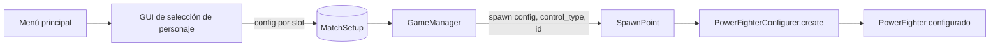

# Nota: Configuración de Power Fighter (PowerFighterConfigurer)

> Cómo se separa el "quién controla" del "qué personaje es", qué hace `PowerFighterConfigurer`,
> cómo lo usa `SpawnPoint` y cómo debería el `GameManager` repartir las configuraciones.
> Verificado el 2026-11-07; actualizado el 2026-11-09. Rutas: `scripts/helpers/global_utils.gd`,
> `scripts/match/power_fighter_configurer.gd`, `scripts/match/spawn_point.gd`,
> `scripts/match/game_manager.gd`, `scripts/characters/person.gd`,
> `scripts/characters/fighter.gd`, `scripts/characters/power_fighter.gd`,
> `scripts/helpers/combat/attacks.gd`, `scripts/helpers/combat/power_attacks.gd`,
> `scripts/helpers/combat/fight_move.gd`.

## Resumen

La configuración de un peleador se partió en dos conceptos independientes:

- **`ControlType`**: quién lo controla (`PLAYER` o `NPC`). No dice nada del modelo ni de sus stats.
- **`PowerFighterConfig`**: qué personaje es (`STANDARD`, `TUX`). No dice nada de quién lo controla.

Con eso, cualquier combinación es válida: un `PLAYER` con Tux, un `NPC` con Standard, etc.
`PowerFighterConfigurer` es la clase que materializa esa combinación: crea el `PowerFighter`
desde el prefab base y le aplica el modelo y el script según los dos enums.

---

## 1. `CharacterType` → `ControlType` + `PowerFighterConfig`

### Antes

`GlobalUtils` tenía un solo enum:

```gdscript
enum CharacterType { PLAYER, NPC }
```

Ese enum mezclaba dos decisiones distintas. Un `CharacterType.PLAYER` no solo decía "lo controla
el jugador", también arrastraba la idea de que el modelo era el único que existía. Agregar un
personaje nuevo (Tux) habría obligado a inventar valores como `PLAYER_TUX` o `NPC_TUX`,
multiplicando combinaciones y rompiendo el `match` de `SpawnPoint`.

### Ahora

`scripts/helpers/global_utils.gd`:

```gdscript
# Enumeración de tipos de personaje que un SpawnPoint puede generar.
enum ControlType { PLAYER, NPC }

# Enumeración de configuraciones disponibles para `power fighter`
enum PowerFighterConfig { STANDARD, TUX }
```

| Enum | Valores | Responde a | Lo usa |
|---|---|---|---|
| `ControlType` | `PLAYER`, `NPC` | ¿Quién lo maneja? | `PowerFighterConfigurer.create`, `SpawnPoint.spawn`, `GameManager` |
| `PowerFighterConfig` | `STANDARD`, `TUX` | ¿Qué modelo/config es? | `PowerFighterConfigurer.create`, `SpawnPoint.spawn`, `GameManager` |

### Por qué importa

- **Combinaciones libres**: `PLAYER + TUX` y `NPC + TUX` funcionan sin tocar enums ni duplicar clases.
- **Crecimiento limpio**: un personaje nuevo solo agrega un valor a `PowerFighterConfig` y un caso
  en el `match` del configurador. No se toca `ControlType`.
- **Responsabilidad clara**: el rol de control y la identidad del personaje se deciden por separado.

---

## 2. `PowerFighterConfigurer`

Vive en `scripts/match/power_fighter_configurer.gd`. Es una clase utilitaria (no es un nodo) con
métodos estáticos. Concentra el "cómo se arma un peleador de una config".

### `create(config, control_type)`

```gdscript
static func create(
	config: GlobalUtils.PowerFighterConfig, control_type: GlobalUtils.ControlType
) -> PowerFighter:
```

Flujo real, en orden:

1. Instancia el prefab base `res://prefabs/standard_power_fighter.tscn`.
2. Si la config es `TUX`, llama a `_build_tux_instance()` para cambiar el modelo visual.
   - `STANDARD`: no hace nada, se queda el modelo que trae el prefab.
3. Asigna el script según el control con un `match`:
   - `ControlType.PLAYER`: `player.gd`.
   - `ControlType.NPC`: `npc.gd`.
4. Si la config es `TUX`, llama a `_apply_tux_config()` para aplicar datos del personaje
   (duraciones, momentum y hitboxes propias de Tux).
5. Retorna el `PowerFighter` ya configurado.

> `_build_tux_instance()` corre antes de `set_script()` para que el modelo ya esté listo cuando se
> monte el script final. `_apply_tux_config()` corre después para llamar setters del script
> definitivo. `_ready()` corre hasta el `add_child()` que hace `GameManager`, con todo ya aplicado.

### `_build_tux_instance()`

Reemplaza el modelo visual del prefab por el de Tux:

```gdscript
static func _build_tux_instance(power_fighter: Node3D) -> void:
	var visual = power_fighter.get_child(0)
	var asset = visual.get_child(0)

	var new_asset = TUX_FIGHTER_ASSET.instantiate()
	var pivot = new_asset.get_child(0)
	var skeleton = pivot.get_child(0)
	var mesh = skeleton.get_child(0)
	mesh.position.y = -1.2

	visual.add_child(new_asset)
	visual.move_child(new_asset, 0)

	visual.remove_child(asset)
	asset.queue_free()
```

- El hijo `0` de la raíz es `Visual`; el hijo `0` de `Visual` es el modelo importado actual.
- El nuevo modelo se agrega y se mueve al índice `0` para conservar el contrato que espera
  `Person._ready()` (el modelo es el primer hijo de `Visual`, `ShieldMeshInstance3D` queda aparte).
- Se ajusta `mesh.position.y = -1.2` porque el esqueleto de Tux viene desplazado en Y respecto al
  modelo standard. El valor es de calibración visual.
- El modelo viejo se saca de `Visual` y se libera.

### `_apply_tux_config()`

Aplica la configuración de datos de Tux. Hoy hace tres cosas:

1. **Duraciones de animación y momentum**: `set_duration_of_anims(0.5)` y `set_momentum(30.0, 50.0, 20.0, 20.0)` (aceleración en piso, fricción en piso, aceleración en aire, fricción de knockback).
2. **Ataques normales**: tiempos de `neutral1/2/3`, `dash`, `heavy_side`, `heavy_up`, `heavy_down`, `air_neutral` y `air_forward/back/up`.
3. **Hitboxes propias**:
   - `neutral1/2/3`, `dash` y `air_neutral` ajustan daño, dirección, posición y tiempos de sus `HitboxMove`.
   - `heavy_down` reemplaza su hitbox por **2 golpes** de 20 de daño, tamaño `(0.5, 0.5, 1.0)`, uno a cada lado, con `init_time_ratio = 0.4` y `duration = 0.1`.
   - `power_attacks.up` y `air_up` reemplazan sus hitboxes por **4 golpes** de 5 de daño, tamaño `(0.5, 0.5, 0.5)`, posición `(0, 1.2, 0)`, con `init_time_ratio` de 0.3 a 0.6 y `duration = 0.05`; además fijan `speed = (6, 0, 0)` y `jump_power = 11.0`.

Es el punto donde viven stats, tiempos y movimientos propios de Tux.

### Contrato de nodos del modelo

`Person._ready()` ya no busca nombres (`"Pivot"`), ahora resuelve por posición
(`scripts/characters/person.gd:944-948`):

```gdscript
var model_root: Node3D = _visual.get_child(0)
_pivot = model_root.get_child(0)            # Pivot
_skeleton3d = _pivot.get_child(0)           # Pivot/Skeleton3D
_mesh_instance = _skeleton3d.get_child(0)   # Pivot/Skeleton3D/MeshInstance3D
_animation_player = model_root.get_node("AnimationPlayer")
```

Por eso todo `.glb` de personaje debe respetar este orden, sin importar los nombres:
`Pivot` → `Skeleton3D` → `MeshInstance3D`, con el `AnimationPlayer` como hijo del modelo. Está
documentado en [asset-personaje.md](../arte/asset-personaje.md). `_build_tux_instance` depende de ese
mismo orden (`new_asset.get_child(0).get_child(0).get_child(0)`).

### Cómo lo usa `SpawnPoint`

`SpawnPoint.spawn()` quedó delgado: ya no preloadea el prefab, los scripts ni los assets. Solo
delega la creación al configurador y remata detalles de spawn:

```gdscript
func spawn(
	config: GlobalUtils.PowerFighterConfig,
	control_type: GlobalUtils.ControlType,
	player_id: int
) -> PowerFighter:
	var power_fighter :PowerFighter = PowerFighterConfigurer.create(config, control_type)

	match control_type:
		GlobalUtils.ControlType.PLAYER:
			power_fighter.player_id = player_id

	power_fighter.init_looking_at_right = init_looking_at_right
	power_fighter.position = global_position
	return power_fighter
```

Responsabilidades resultantes:

- `PowerFighterConfigurer`: **qué** es (modelo + script de control).
- `SpawnPoint`: **dónde** aparece (posición del marcador), orientación inicial y `player_id`.

### Material: estado actual

`Person._set_material()` está temporalmente desactivado (`scripts/characters/person.gd:187`):

```gdscript
pass #_mesh_instance.material_override = p_meterial
```

Consecuencia: se conserva el material que trae el `.glb` (la textura de Tux), y el color por slot
que asigna `GameManager` queda ignorado. Es la decisión actual para poder ver Tux con su textura.
Reactivar el `material_override` volvería a pintar al peleador de un color sólido y taparía la
textura.

### Configuración fina de movimientos

`Fighter` expone su catálogo de ataques como `attacks` (`Attacks`, 15 `FightMove`) y `PowerFighter`
expone `power_attacks` (`PowerAttacks`, 6 `FightMove`). Ambos son **públicos**: el configurador
puede entrar directo a cada slot y ajustar sus valores.

`FightMove.name` quedó como **solo lectura** (`scripts/helpers/combat/fight_move.gd:27-30`):

```gdscript
var _name: StringName
var name: StringName:
	get:
		return _name
```

El nombre se fija al construir el `FightMove` y ya no se puede reasignar desde fuera. Los demás
campos (`duration`, `speed`, `direction`, `jump_power`, `hitboxes_moves`, etc.) siguen públicos.
Eso permite cambiar números sin romper el nombre de animación, que es el clip que `_attack_anim()`
reproduce (`scripts/characters/fighter.gd:595`).

Ejemplo de uso desde el configurador:

```gdscript
var move := power_fighter.power_attacks.standard
move.duration = 0.4
move.hitboxes_moves[0].damage = 12
# move.name = &"otra_cosa"  -> error: la propiedad es de solo lectura
```

#### Límites actuales

- `attacks` y `power_attacks` son contenedores públicos, así que todavía se puede reemplazar un slot
  completo por otro `FightMove` (con el nombre que traiga) o por `null`. La protección del nombre
  aplica solo si se muta el `FightMove` existente.
- Si se quisiera blindar también el reemplazo de slots, harían falta setters por slot con validación
  o slots de solo lectura. No es el caso hoy.

#### Combo neutral

`_neutral_combo_attacks` se llena en `_ready()` (`scripts/characters/fighter.gd:861`) con las
referencias de `attacks.neutral1/2/3`. Mutar esos `FightMove` en sitio es seguro: el combo apunta a
los mismos objetos. Si algún día se reemplaza un `FightMove` del combo después de `_ready()`, habría
que refrescar el arreglo.

#### Fuera de alcance por ahora

- Validar en `_ready()` que existan todos los clips en el `AnimationPlayer`.
- Setters por slot para reemplazar movimientos completos con validación de nombre.

---

## 3. Cómo asigna el `GameManager` las configuraciones

### Estado actual

La selección de personaje ya existe (`ui/character_menu.tscn`) y llena `MatchSetup` antes de cambiar
de escena. `GameManager._spawn_all_power_fighters()` lee `MatchSetup.slots` y le pasa a
`SpawnPoint.spawn()` el `config` y el `ControlType` de cada slot.

Si `MatchSetup.slots` está vacío (por ejemplo, `map1.tscn` abierto directo desde el editor), el
respaldo arma 2 `PLAYER` + 2 `NPC` con `config` aleatoria entre las disponibles:

```gdscript
var config_options := [GlobalUtils.PowerFighterConfig.STANDARD, GlobalUtils.PowerFighterConfig.TUX]
for i in range(0, 4):
	var control := GlobalUtils.ControlType.PLAYER if i < 2 else GlobalUtils.ControlType.NPC
	slots.append({ "control": control, "config": config_options.pick_random(), "player_id": i })
```

### Implementación

El `GameManager` **no decide** qué personaje es cada quién: **recibe** una lista de configuraciones,
una por slot, y se limita a pasarlas a `SpawnPoint.spawn()`.

La fuente natural de esa lista es una **GUI de selección de personaje** entre el menú principal y
la partida. Cada jugador elige su personaje (y en el futuro su color/skin); los slots de NPC se
asignan por defecto o al azar.

Flujo actual:



Pasos implementados:

1. **Guardar la selección**: ya implementado con `MatchSetup` (static), que sobrevive al cambio de
   escena y expone `lives`, `time_limit_minutes` y `slots`.
2. **`GameManager` lee la config por slot**: ya implementado en `_get_match_slots()`.

3. **`SpawnPoint.spawn(config, control_type, player_id)`** sigue igual: recibe y delega. No necesita
   saber de dónde salió la config.
4. **La GUI no conoce `PowerFighterConfigurer`**: solo produce enums de `PowerFighterConfig`. El
   configurador se encarga del resto.

### Qué falta decidir

- **NPCs**: hoy el respaldo usa config aleatoria; la selección de personaje puede fijarla por slot.
- **Material/tinte por slot**: con la textura de Tux conservada, hoy no hay color por jugador. Si se
  quiere distinguir jugadores con Tux, habría que definir un material que tiña sin tapar la textura,
  y decidir si eso vive en `PowerFighterConfig` o se queda como color por slot.
- **Stats y ataques por config**: cuando cada personaje tenga datos propios, `PowerFighterConfigurer`
  debería aplicar stats/tiempos y los movimientos por slot (ver "Configuración fina de movimientos")
  desde la misma config.
- **Vidas y tiempo**: `MatchSetup.lives` y `MatchSetup.time_limit_minutes` todavía no se aplican en
  la partida; el spawn usa `lives_per_character` y el cronómetro no lee el límite.

---

## Archivos involucrados

| Archivo | Cambio |
|---|---|
| `scripts/helpers/global_utils.gd` | `CharacterType` → `ControlType`; nuevo enum `PowerFighterConfig` |
| `scripts/match/power_fighter_configurer.gd` | Nuevo: crea y configura el `PowerFighter` |
| `scripts/match/spawn_point.gd` | Delega la creación al configurador; solo posiciona y asigna `player_id` |
| `scripts/match/game_manager.gd` | Lee `MatchSetup.slots` y pasa `config`/`ControlType` a `spawn()`; respaldo 2 Player + 2 NPC random |
| `scripts/characters/person.gd` | Resuelve nodos esenciales por índice; `_skeleton3d` |
| `scripts/characters/fighter.gd` | `attacks` público; ya no tiene `set_attacks()` |
| `scripts/characters/power_fighter.gd` | `power_attacks` público; ya no tiene `set_power_attacks()` |
| `scripts/helpers/combat/fight_move.gd` | `name` de solo lectura (`_name` + getter) |
| `docs/arte/asset-personaje.md` | Documenta el orden obligatorio de nodos del modelo |

## Ver también

- [asset-personaje.md](../arte/asset-personaje.md): contrato de nodos y nombres de animación.
- [nota-escalabilidad-personajes.md](nota-escalabilidad-personajes.md): problemas de escalar el roster.
- [nota-game-manager-modular.md](nota-game-manager-modular.md): módulos de la partida y responsabilidades.
