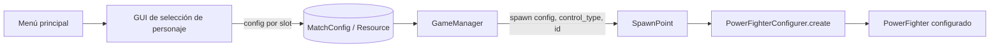

# Nota: Configuración de Power Fighter (PowerFighterConfigurer)

> Cómo se separa el "quién controla" del "qué personaje es", qué hace `PowerFighterConfigurer`,
> cómo lo usa `SpawnPoint` y cómo debería el `GameManager` repartir las configuraciones.
> Verificado el 2026-11-06. Rutas: `scripts/helpers/global_utils.gd`,
> `scripts/match/power_fighter_configurer.gd`, `scripts/match/spawn_point.gd`,
> `scripts/match/game_manager.gd`, `scripts/characters/person.gd`.

## Resumen

La configuración de un peleador se partió en dos conceptos independientes:

- **`ControlType`**: quién lo controla (`PLAYER` o `NPC`). No dice nada del modelo ni de sus stats.
- **`PowerFighterConfig`**: qué personaje es (`STANDARD`, `TUX`). No dice nada de quién lo controla.

Con eso, cualquier combinación es válida: un `PLAYER` con Tux, un `NPC` con Standard, etc.
`PowerFighterConfigurer` es la clase que materializa esa combinación: crea el `PowerFighter`
desde el prefab base y le aplica el modelo y el script según los dos enums.

---

## 1. `CharacterType` → `ControlType` + `PowerFighterConfig`

### Antes

`GlobalUtils` tenía un solo enum:

```gdscript
enum CharacterType { PLAYER, NPC }
```

Ese enum mezclaba dos decisiones distintas. Un `CharacterType.PLAYER` no solo decía "lo controla
el jugador", también arrastraba la idea de que el modelo era el único que existía. Agregar un
personaje nuevo (Tux) habría obligado a inventar valores como `PLAYER_TUX` o `NPC_TUX`,
multiplicando combinaciones y rompiendo el `match` de `SpawnPoint`.

### Ahora

`scripts/helpers/global_utils.gd`:

```gdscript
# Enumeración de tipos de personaje que un SpawnPoint puede generar.
enum ControlType { PLAYER, NPC }

# Enumeración de configuraciones disponibles para `power fighter`
enum PowerFighterConfig { STANDARD, TUX }
```

| Enum | Valores | Responde a | Lo usa |
|---|---|---|---|
| `ControlType` | `PLAYER`, `NPC` | ¿Quién lo maneja? | `PowerFighterConfigurer.create`, `SpawnPoint.spawn`, `GameManager` |
| `PowerFighterConfig` | `STANDARD`, `TUX` | ¿Qué modelo/config es? | `PowerFighterConfigurer.create`, `SpawnPoint.spawn`, `GameManager` |

### Por qué importa

- **Combinaciones libres**: `PLAYER + TUX` y `NPC + TUX` funcionan sin tocar enums ni duplicar clases.
- **Crecimiento limpio**: un personaje nuevo solo agrega un valor a `PowerFighterConfig` y un caso
  en el `match` del configurador. No se toca `ControlType`.
- **Responsabilidad clara**: el rol de control y la identidad del personaje se deciden por separado.

---

## 2. `PowerFighterConfigurer`

Vive en `scripts/match/power_fighter_configurer.gd`. Es una clase utilitaria (no es un nodo) con
métodos estáticos. Concentra el "cómo se arma un peleador de una config".

### `create(config, control_type)`

```gdscript
static func create(
	config: GlobalUtils.PowerFighterConfig, control_type: GlobalUtils.ControlType
) -> PowerFighter:
```

Flujo:

1. Instancia el prefab base `res://prefabs/standard_power_fighter.tscn`.
2. Aplica la configuración de personaje con un `match`:
   - `PowerFighterConfig.STANDARD`: no hace nada, se queda el modelo que trae el prefab.
   - `PowerFighterConfig.TUX`: llama a `_apply_tux_config()`.
3. Asigna el script según el control con otro `match`:
   - `ControlType.PLAYER`: `player.gd`.
   - `ControlType.NPC`: `npc.gd`.
4. Retorna el `PowerFighter` ya configurado.

> El `set_script()` ocurre antes del `add_child`, así que el `_init()` y el `_ready()` del script
> elegido corren ya con la configuración correcta.

### `_apply_tux_config()`

Reemplaza el modelo visual del prefab por el de Tux:

```gdscript
static func _apply_tux_config(power_fighter: Node3D) -> void:
	var visual = power_fighter.get_child(0)
	var asset = visual.get_child(0)

	var new_asset = TUX_FIGHTER_ASSET.instantiate()
	var pivot = new_asset.get_child(0)
	var skeleton = pivot.get_child(0)
	var mesh = skeleton.get_child(0)
	mesh.position.y = -1.2

	visual.add_child(new_asset)
	visual.move_child(new_asset, 0)

	visual.remove_child(asset)
	asset.queue_free()
```

- El hijo `0` de la raíz es `Visual`; el hijo `0` de `Visual` es el modelo importado actual.
- El nuevo modelo se agrega y se mueve al índice `0` para conservar el contrato que espera
  `Person._ready()` (el modelo es el primer hijo de `Visual`, `ShieldMeshInstance3D` queda aparte).
- Se ajusta `mesh.position.y = -1.2` porque el esqueleto de Tux viene desplazado en Y respecto al
  modelo standard. El valor es de calibración visual.
- El modelo viejo se saca de `Visual` y se libera.

### Contrato de nodos del modelo

`Person._ready()` ya no busca nombres (`"Pivot"`), ahora resuelve por posición
(`scripts/characters/person.gd:944-948`):

```gdscript
var model_root: Node3D = _visual.get_child(0)
_pivot = model_root.get_child(0)            # Pivot
_skeleton3d = _pivot.get_child(0)           # Pivot/Skeleton3D
_mesh_instance = _skeleton3d.get_child(0)   # Pivot/Skeleton3D/MeshInstance3D
_animation_player = model_root.get_node("AnimationPlayer")
```

Por eso todo `.glb` de personaje debe respetar este orden, sin importar los nombres:
`Pivot` → `Skeleton3D` → `MeshInstance3D`, con el `AnimationPlayer` como hijo del modelo. Está
documentado en [asset-personaje.md](../arte/asset-personaje.md). `_apply_tux_config` depende de ese
mismo orden (`new_asset.get_child(0).get_child(0).get_child(0)`).

### Cómo lo usa `SpawnPoint`

`SpawnPoint.spawn()` quedó delgado: ya no preloadea el prefab, los scripts ni los assets. Solo
delega la creación al configurador y remata detalles de spawn:

```gdscript
func spawn(
	config: GlobalUtils.PowerFighterConfig,
	control_type: GlobalUtils.ControlType,
	player_id: int
) -> PowerFighter:
	var power_fighter :PowerFighter = PowerFighterConfigurer.create(config, control_type)

	match control_type:
		GlobalUtils.ControlType.PLAYER:
			power_fighter.player_id = player_id

	power_fighter.init_looking_at_right = init_looking_at_right
	power_fighter.position = global_position
	return power_fighter
```

Responsabilidades resultantes:

- `PowerFighterConfigurer`: **qué** es (modelo + script de control).
- `SpawnPoint`: **dónde** aparece (posición del marcador), orientación inicial y `player_id`.

### Material: estado actual

`Person._set_material()` está temporalmente desactivado (`scripts/characters/person.gd:187`):

```gdscript
pass #_mesh_instance.material_override = p_meterial
```

Consecuencia: se conserva el material que trae el `.glb` (la textura de Tux), y el color por slot
que asigna `GameManager` queda ignorado. Es la decisión actual para poder ver Tux con su textura.
Reactivar el `material_override` volvería a pintar al peleador de un color sólido y taparía la
textura.

### Configuración fina de movimientos (propuesta)

En vez de reemplazar todo el moveset de golpe, conviene poder cambiar un movimiento a la vez por
slot. Los nombres de slot ya están fijos por arquitectura en `_init_attack_by_move()`
(`scripts/characters/fighter.gd:408`), así que no se tocan. Lo que sí hay que cuidar es el
**nombre de animación** (`FightMove.name`), porque es el clip que `_attack_anim()` reproduce
(`scripts/characters/fighter.gd:604`).

Exponer los contenedores (`_attacks`, `_power_attacks`) permitiría meter un `FightMove` con nombre
de animación vacío o equivocado, y el ataque quedaría mudo sin avisar. Por eso la propuesta es un
setter por slot con validación.

#### API propuesta

`Attacks` y `PowerAttacks` exponen un mapa canónico slot → animación y un setter:

```gdscript
# attacks.gd
const SLOT_ANIMATION := {
	&"neutral1": &"neutral_attack1",
	&"neutral2": &"neutral_attack2",
	&"neutral3": &"neutral_attack3",
	&"down": &"down_attack",
	&"up": &"up_attack",
	&"dash": &"dash_attack",
	&"forward": &"forward_attack",
	&"heavy_side": &"heavy_side_attack",
	&"heavy_up": &"heavy_up_attack",
	&"heavy_down": &"heavy_down_attack",
	&"air_neutral": &"air_neutral_attack",
	&"air_down": &"air_down_attack",
	&"air_up": &"air_up_attack",
	&"air_forward": &"air_forward_attack",
	&"air_back": &"air_back_attack",
}

func set_move(slot: StringName, move: FightMove) -> bool:
	# valida slot, move y nombre de animación antes de asignar
```

`PowerAttacks` usa el mismo patrón con sus 6 slots:

| Slot | Animación |
|---|---|
| `standard` | `power_attack` |
| `down` | `down_power_attack` |
| `up` | `up_power_attack` |
| `air_standard` | `air_power_attack` |
| `air_down` | `air_down_power_attack` |
| `air_up` | `air_up_power_attack` |

Y `Fighter` / `PowerFighter` delegan:

```gdscript
func set_attack(slot: StringName, move: FightMove) -> bool
func set_power_attack(slot: StringName, move: FightMove) -> bool
```

#### Validación y crash

- Slot inexistente, `FightMove` nulo o `move.name` distinto del canónico → error con mensaje.
- GDScript no tiene `try/catch`; lo más cercano a una excepción con mensaje es
  `push_error(msg)` + `assert(false, msg)`, que detiene la ejecución en debug.
- En builds release `assert` se elimina; el setter debe regresar `false` y dejar el moveset intacto.

#### Combo neutral

`_neutral_combo_attacks` se llena una sola vez en `_ready()`
(`scripts/characters/fighter.gd:869`). Los setters de `neutral1/2/3` deben refrescarlo con un
`_refresh_neutral_combo()`, o el combo seguiría apuntando a los moves viejos.

#### Fuera de alcance por ahora

- No se valida que existan todos los clips en el `AnimationPlayer` al hacer `_ready()`.
- Los contenedores de ataques no se exponen como públicos.

---

## 3. Cómo debería el `GameManager` asignar configuraciones

### Estado actual

`GameManager._spawn_all_power_fighters()` todavía hardcodea la config para los 4 slots
(`scripts/match/game_manager.gd:78`):

```gdscript
var config = GlobalUtils.PowerFighterConfig.STANDARD
if is_player:
	power_fighter = spawn_point.spawn(config, GlobalUtils.ControlType.PLAYER, i)
else:
	power_fighter = spawn_point.spawn(config, GlobalUtils.ControlType.NPC, i)
```

Es decir: todos los peleadores salen `STANDARD`. El `ControlType` sí varía por slot (1-2 Player,
3-4 NPC), pero la identidad del personaje aún no.

### Propuesta

El `GameManager` **no debería decidir** qué personaje es cada quién. Debería **recibir** una lista
de configuraciones, una por slot, y limitarse a pasarlas a `SpawnPoint.spawn()`.

La fuente natural de esa lista es una **GUI de selección de personaje** entre el menú principal y
la partida. Cada jugador elige su personaje (y en el futuro su color/skin); los slots de NPC se
asignan por defecto o al azar.

Flujo propuesto:



Pasos sugeridos:

1. **Guardar la selección** en un lugar que sobreviva al cambio de escena. Dos opciones:
   - **Autoload** `MatchConfig` (más simple): expone `configs: Array[GlobalUtils.PowerFighterConfig]`
     con 4 entradas.
   - **Resource `.tres`** cargado por la escena del nivel (más testeable y desacoplado).
2. **`GameManager` lee la config por slot** en vez de hardcodear:

   ```gdscript
   var configs := MatchConfig.configs  # o el resource inyectado
   var config := configs[i]
   ```

3. **`SpawnPoint.spawn(config, control_type, player_id)`** sigue igual: recibe y delega. No necesita
   saber de dónde salió la config.
4. **La GUI no conoce `PowerFighterConfigurer`**: solo produce enums de `PowerFighterConfig`. El
   configurador se encarga del resto.

### Qué falta decidir

- **Dónde vive la selección**: autoload vs resource en la escena del nivel.
- **NPCs**: ¿config fija por defecto (`STANDARD`), aleatoria entre las disponibles, o definida por
  el mapa?
- **Material/tinte por slot**: con la textura de Tux conservada, hoy no hay color por jugador. Si se
  quiere distinguir jugadores con Tux, habría que definir un material que tiña sin tapar la textura,
  y decidir si eso vive en `PowerFighterConfig` o se queda como color por slot.
- **Stats y ataques por config**: cuando cada personaje tenga datos propios, `PowerFighterConfigurer`
  debería aplicar stats/tiempos y los movimientos por slot (ver "Configuración fina de movimientos")
  desde la misma config.

---

## Archivos involucrados

| Archivo | Cambio |
|---|---|
| `scripts/helpers/global_utils.gd` | `CharacterType` → `ControlType`; nuevo enum `PowerFighterConfig` |
| `scripts/match/power_fighter_configurer.gd` | Nuevo: crea y configura el `PowerFighter` |
| `scripts/match/spawn_point.gd` | Delega la creación al configurador; solo posiciona y asigna `player_id` |
| `scripts/match/game_manager.gd` | Pasa `config` y `ControlType` a `spawn()` (config aún fija en `STANDARD`) |
| `scripts/characters/person.gd` | Resuelve nodos esenciales por índice; `_skeleton3d` |
| `docs/arte/asset-personaje.md` | Documenta el orden obligatorio de nodos del modelo |

## Ver también

- [asset-personaje.md](../arte/asset-personaje.md): contrato de nodos y nombres de animación.
- [nota-escalabilidad-personajes.md](nota-escalabilidad-personajes.md): problemas de escalar el roster.
- [nota-game-manager-modular.md](nota-game-manager-modular.md): módulos de la partida y responsabilidades.
