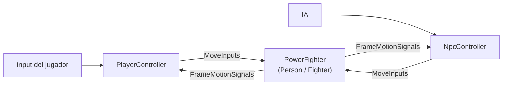

# Nota: Power Fighter Controller (propuesta)

> Propuesta **NO implementada**. Reemplaza `Player`/`NPC` por controladores por composición para
> sacar el rol de la herencia y dejar de usar `set_script` (que borra los `@export` de escena).
> Verificado contra el código el 2026-11-14.
> Rutas: `scripts/characters/player.gd`, `scripts/characters/npc.gd`,
> `scripts/characters/person.gd`, `scripts/characters/power_fighter.gd`,
> `scripts/match/power_fighter_configurer.gd`, `scripts/match/spawn_point.gd`,
> `scripts/match/lives_manager.gd`, `scripts/helpers/global_utils.gd`,
> `prefabs/standard_power_fighter.tscn`.

## Resumen

Hoy el rol de un peleador se decide con `set_script` en `PowerFighterConfigurer.create()`
(`player.gd` para `PLAYER`, `npc.gd` para `NPC`). Eso arrastra dos problemas:

1. **`set_script` borra los `@export` de escena.** `Object::set_script` recrea el `script_instance`
   del nodo, así que cualquier valor exportado que traiga el prefab se reinicia a su default. Es la
   razón por la que `Person.stream_jump` llega `null` en partida aunque el prefab lo traiga puesto:
   el configurador cambia el script después de instanciar y se pierde lo asignado en la escena.
2. **Herencia única.** `Player` y `NPC` heredan de `PowerFighter`. Un personaje con script propio
   (`extends PowerFighter`) no puede además ser `Player` ni `NPC`, así que cada personaje nuevo
   exige crear `PlayerX` y `NPCX` (ver
   [nota-escalabilidad-personajes.md](nota-escalabilidad-personajes.md), problema 4).

La propuesta: el peleador es **una sola clase** (`PowerFighter`) y el rol vive en un **nodo hijo**
`PowerFighterController` que solo decide los inputs. Como ya no se usa `set_script`, los `@export`
del prefab sobreviven y el prefab se configura sin pedos.

> Nota: el [problema 2 de escalabilidad](nota-escalabilidad-personajes.md) ya planteaba
> "Player/NPC como controladores por composición". Esta nota aterriza el diseño y las decisiones.

## Qué resuelve

| Problema | Antes | Con controller |
|---|---|---|
| `@export` del prefab | Se borran al `set_script` | Sobreviven (no hay `set_script`) |
| Rol de jugador/NPC | Herencia (`Player`/`NPC extends PowerFighter`) | Composición (nodo hijo) |
| Personaje nuevo | Requiere `PlayerX` + `NPCX` | Un solo `PowerFighter` + controller reusado |
| Rol no-humano (demo, replay, script) | No existe | Cualquier controller nuevo |

## Diseño

### Clases

- **`PowerFighterController`** (base, `extends Node3D`): nodo hijo del peleador. Solo traduce
  "quién decide" en inputs. No conoce `Person`/`Fighter`/`PowerFighter`.
- **`PlayerController`**: lee `Input` con el mapa del jugador. Guarda `player_id` e `input_map`.
- **`NpcController`**: la IA actual de `npc.gd` + su `Area3D` de detección.

Se llama `PowerFighterController` porque, por ahora, lo único que se controla es un `PowerFighter`.
Si más adelante hay peleadores sin poderes, se puede renombrar/bajar a una base común.

### `MoveInputs` (salida)

Objeto `RefCounted` con los flags que hoy son campos de `Person`:

```gdscript
# scripts/helpers/frame/move_inputs.gd  (o helpers/)
class_name MoveInputs
extends RefCounted

var move_left: bool = false
var move_right: bool = false
var move_up: bool = false
var move_down: bool = false
var jump: bool = false
var attack: bool = false
var walk: bool = false
var grab: bool = false
var shield: bool = false
var power_attack: bool = false

func reset() -> void:
	move_left = false
	move_right = false
	move_up = false
	move_down = false
	jump = false
	attack = false
	walk = false
	grab = false
	shield = false
	power_attack = false
```

### Interfaz del controller

```gdscript
class_name PowerFighterController
extends Node3D

func collect_input(inputs: MoveInputs) -> void:
	pass

func process_ai(delta: float, frame: FrameMotionSignals, inputs: MoveInputs) -> void:
	pass

func get_default_material() -> Material:
	return null
```

- **Entrada**: `delta` y `frame` (`FrameMotionSignals`), que `Person` ya arma por frame.
- **Salida**: el `MoveInputs` que recibe por parámetro.
- **Apariencia**: `get_default_material()` devuelve el material; `Person` lo aplica. Es solo salida.

### `Person`

`Person` gana dos miembros y reenvía sus hooks actuales:

```gdscript
var inputs: MoveInputs = MoveInputs.new()
var controller: PowerFighterController = null

func _collect_input() -> void:
	if controller:
		controller.collect_input(inputs)

func _process_ai(delta: float, frame: FrameMotionSignals) -> void:
	if controller:
		controller.process_ai(delta, frame, inputs)

func _get_default_material() -> Material:
	if controller:
		return controller.get_default_material()
	return null
```

El orden de `_physics_process` no cambia: `_collect_input()` y `_process_ai()` siguen corriendo
antes de `_build_frame()` (ver `person.gd:1207-1210`). `inputs.reset()` se hace antes de
`collect_input()`.

### Flujo



## Decoupling: el controller no toca al person

El controller **no** debe acceder a `Person`/`Fighter`/`PowerFighter`. La comunicación es por
objetos neutrales:

- **Escribe** en el `MoveInputs` que recibe.
- **Lee** `delta` y `frame`.
- **Devuelve** material (solo salida).

Consecuencia: `Person` deja de leer sus propios bools y lee `inputs.move_left`, etc.

### Huecos a resolver

Si el controller no ve al person, hay datos que hoy `npc.gd` toma de `self` y no están en el frame:

| Dato | Uso hoy | Opción |
|---|---|---|
| `global_position` | Detección de plataformas/personas | Controller `Node3D`: usa su propio `global_position` (su `Area3D` cuelga de él) |
| `_jump_count` | Decidir salto turbo | Mandarlo en el `frame` o en un objeto de estado aparte |
| `_max_jumps`, `jump_impulse`, `fall_acceleration` | Calcular altura de salto | Objeto de stats, o valores propios del controller |
| `_holding_onto_the_ledge()` | Detección de orilla | Exponerlo como estado en el `frame`/objeto |

Esto es lo único que falta cerrar antes de implementar.

## Decisiones tomadas

- **Rol = composición, no herencia.** El peleador siempre es `PowerFighter`; el rol es un controller.
- **El controller solo decide inputs.** No decide si es `Person`/`Fighter`/`PowerFighter`; esas son
  capas de capacidad y las decide el prefab.
- **El controller no accede al person.** Entrada `delta`/`frame`, salida `MoveInputs`.
- **`player_id` se muda al `PlayerController`.** Implica ajustar `spawn_point.gd` y `lives_manager.gd`.
- **`player.gd` y `npc.gd` se borran** cuando el refactor ya funcione.
- **El configurer hace `set_controller` en vez de `set_script`.**

## Impacto en el resto

| Archivo | Cambio |
|---|---|
| `scripts/match/power_fighter_configurer.gd` | `set_script` → `set_controller(PlayerController/NpcController)`; ya no preloadea `player.gd`/`npc.gd` |
| `scripts/match/spawn_point.gd` | `power_fighter.player_id = ...` → al `PlayerController` |
| `scripts/match/lives_manager.gd:108` | `power_fighter is Player` → `power_fighter.controller is PlayerController` |
| `prefabs/standard_power_fighter.tscn` | Root con `script = power_fighter.gd` para que existan los `@export` |
| `scripts/characters/person.gd` | `inputs` + `controller` + reenvío de hooks |
| `scripts/characters/player.gd`, `npc.gd` | Se eliminan al terminar |

## Plan por pasos

1. Documentar (esta nota) y actualizar `docs/estructura.md`.
2. Crear `scripts/characters/controllers/`: `power_fighter_controller.gd`, `player_controller.gd`,
   `npc_controller.gd`.
3. Crear `MoveInputs` (`scripts/helpers/`).
4. Adaptar `person.gd`: `inputs`, `controller`, reenvío de hooks, `_get_default_material`.
5. Mover la lógica de `player.gd`/`npc.gd` a los controllers (NPC: `self` → su `global_position`;
   stats desde donde se decida).
6. Configurer: `set_controller` en vez de `set_script`.
7. Prefab: root con `script = power_fighter.gd`.
8. Ajustar `lives_manager.gd` y `spawn_point.gd`.
9. Borrar `player.gd`/`npc.gd`.
10. Probar: spawn de player y NPC, movimiento, ataques, y que los `@export` del prefab sobrevivan.

## Preguntas abiertas

- NPC: ¿controller `Node3D` con su propio `global_position` + `Area3D`, o se pasa la posición por frame?
- Stats del NPC (`jump_impulse`, `fall_acceleration`, `_max_jumps`): ¿al `frame`, a un objeto aparte,
  o propias del controller?
- ¿El nombre final es `PowerFighterController` o algo más genérico cuando haya personajes sin poderes?

## Ver también

- [nota-escalabilidad-personajes.md](nota-escalabilidad-personajes.md): problemas de escalar el roster.
- [nota-power-fighter-configurer.md](nota-power-fighter-configurer.md): quién arma al peleador hoy.
- [arquitectura-personajes.md](arquitectura-personajes.md): jerarquía `Person` → `Fighter` → `PowerFighter`.
- [../arte/audio.md](../arte/audio.md): caso que motivó el fix (los `@export` de SFX borrados).
