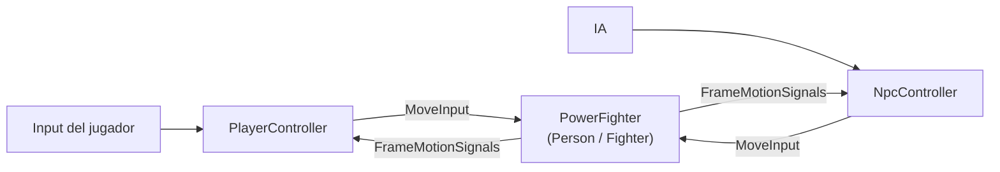

# Nota: Controladores por composición (`PersonController3D`)

> **Implementado** al 2026-11-16. `PlayerController` y `NpcController` ya funcionan en partida, la
> limpieza menor está hecha y la prueba 1 player + 1 NPC pasó (ver [../ia/nota-ai-npc.md](../ia/nota-ai-npc.md)).
> Verificado contra el working tree el 2026-11-16.
> Rutas: `scripts/characters/person_controller_3d.gd`, `scripts/characters/player_controller.gd`,
> `scripts/characters/npc_controller.gd`, `scripts/helpers/frame/move_input.gd`,
> `scripts/helpers/frame/jump_signals.gd`, `scripts/characters/person.gd`,
> `scripts/characters/power_fighter.gd`, `scripts/match/power_fighter_configurer.gd`,
> `scripts/match/spawn_point.gd`, `scripts/match/lives_manager.gd`, `scripts/ui/fight_hud.gd`,
> `prefabs/standard_power_fighter.tscn`.

## Resumen

Antes, el rol de un peleador se decidía con `set_script` en `PowerFighterConfigurer.create()`
(`player.gd` para `PLAYER`, `npc.gd` para `NPC`). Eso arrastraba dos problemas:

1. **`set_script` borra los `@export` de escena.** `Object::set_script` recrea el `script_instance`
   del nodo, así que cualquier valor exportado que traiga el prefab se reinicia a su default. Fue la
   razón por la que `Person.stream_jump` llegaba `null` en partida aunque el prefab lo trajera puesto:
   el configurador cambiaba el script después de instanciar y se perdía lo asignado en la escena.
2. **Herencia única.** `Player` y `NPC` heredaban de `PowerFighter`. Un personaje con script propio
   (`extends PowerFighter`) no podía además ser `Player` ni `NPC`, así que cada personaje nuevo
   exigía crear `PlayerX` y `NPCX` (ver
   [nota-escalabilidad-personajes.md](nota-escalabilidad-personajes.md), problema 4).

La solución: el peleador es **una sola clase** (`PowerFighter`) y el rol vive en un **nodo hijo**
`PersonController3D` que solo decide los inputs. Como ya no se usa `set_script`, los `@export` del
prefab sobreviven y el prefab se configura sin pedos.

> Nota: el [problema 2 de escalabilidad](nota-escalabilidad-personajes.md) ya planteaba
> "Player/NPC como controladores por composición". Esta nota aterriza el diseño y las decisiones.

## Qué resuelve

| Problema | Antes | Con controller |
|---|---|---|
| `@export` del prefab | Se borran al `set_script` | Sobreviven (no hay `set_script`) |
| Rol de jugador/NPC | Herencia (`Player`/`NPC extends PowerFighter`) | Composición (nodo hijo) |
| Personaje nuevo | Requiere `PlayerX` + `NPCX` | Un solo `PowerFighter` + controller reusado |
| Rol no-humano (demo, replay, script) | No existe | Cualquier controller nuevo |

## Diseño

### Clases

- **`PersonController3D`** (base, `extends Node3D`, `scripts/characters/person_controller_3d.gd`):
  nodo hijo del peleador. Solo traduce "quién decide" en inputs. No conoce
  `Person`/`Fighter`/`PowerFighter`.
- **`PlayerController`** (`scripts/characters/player_controller.gd`): lee `Input` con el mapa del
  jugador. Guarda `player_id` y `player_input_map`.
- **`NpcController`** (`scripts/characters/npc_controller.gd`): la IA de `npc.gd` + su `Area3D` de
  detección como hija del controller.

Se llama `PersonController3D` (y no `PowerFighterController`) porque lo que se controla es un `Person`
y sus hijos; es la base común para peleadores con o sin poderes.

### `MoveInput` (salida)

Objeto `RefCounted` con los flags que hoy son campos de `Person`/`Fighter`/`PowerFighter`
(`scripts/helpers/frame/move_input.gd`):

```gdscript
class_name MoveInput
extends RefCounted

# Person
var move_left: bool = false
var move_right: bool = false
var move_up: bool = false
var move_down: bool = false
var jump: bool = false
var walk: bool = false

# Fighter
var attack: bool = false
var grab: bool = false
var shield: bool = false

# PowerFighter
var power_attack: bool = false
```

### Interfaz del controller

```gdscript
class_name PersonController3D
extends Node3D

var _input: MoveInput = MoveInput.new()

func get_input(delta: float, frame: FrameMotionSignals) -> MoveInput:
	return _input
```

- **Entrada**: `delta` y `frame` (`FrameMotionSignals`), que `Person` ya arma por frame. El player no
  los usa; el NPC sí.
- **Salida**: devuelve **su propio `MoveInput` reutilizado** (misma instancia cada frame, cero basura).
- **`frame` es `null` en el primer frame** (`Person._last_frame` arranca en `null`): cada controller
  debe tolerarlo.

### `Person`

`Person` gana la propiedad `controller` (nodo hijo) y reenvía sus hooks:

```gdscript
var _controller: PersonController3D

var controller: PersonController3D:
	get:
		return _controller
	set(value):
		if _controller == value: return
		if _controller and is_instance_valid(_controller):
			_controller.queue_free()
		_controller = value
		if not _controller.is_inside_tree():
			add_child(_controller)

func _collect_controller_input(delta: float, frame: FrameMotionSignals) -> void:
	var input :MoveInput = _controller.get_input(delta, frame)
	_move_left = input.move_left
	_move_right = input.move_right
	_move_up = input.move_up
	_move_down = input.move_down
	_walk = input.walk
	_jump = input.jump

func _process_controller(delta: float, frame: FrameMotionSignals) -> void:
	if _controller is PersonController3D:
		_collect_controller_input(delta, frame)
```

- El controller se **agrega como hijo** desde el setter (encapsula reemplazo y lifetime).
- `Person` **copia** el `MoveInput` a sus propios bools (la base copia 6). `PowerFighter` sobreescribe
  `_collect_controller_input` para copiar también `attack`, `grab`, `shield` y `power_attack`.
- `_physics_process` corre `_process_controller(delta, _last_frame)` **al inicio**, antes de
  `_build_frame()`.
- Los hooks viejos `_collect_input()` y `_process_ai()` ya se borraron (2026-11-16): el controller
  es la única fuente de input.

### Flujo



## Decoupling: el controller no toca al person

El controller **no** debe acceder a `Person`/`Fighter`/`PowerFighter`. La comunicación es por objetos
neutrales:

- **Escribe** en su `MoveInput` (que devuelve con `get_input`).
- **Lee** `delta` y `frame`.
- **Usa su propio `global_position`** (es `Node3D`), que coincide con el del peleador porque es su hijo
  directo.

Consecuencia: `Person` copia los valores del `MoveInput` a sus bools, en vez de que el controller los
escriba directo.

### Datos que la IA saca del person

El controller no ve al person, así que estos datos que hoy `npc.gd` tomaba de `self` viajan por el
`frame` (no por un objeto de stats aparte):

| Dato | Uso | Cómo viaja |
|---|---|---|
| `global_position` | Detección de plataformas/personas | **Resuelto**: el controller es `Node3D` y su `Area3D` cuelga de él |
| `_jump_count`, `_max_jumps` | Decidir salto turbo (`count >= max`) | **Resuelto**: `frame.jump_signals.count` / `.max` |
| `jump_impulse`, `fall_acceleration` | Calcular altura de salto | **Resuelto**: `frame.jump_signals.impulse` / `.fall_acceleration` |
| `_holding_onto_the_ledge()` | Detección de orilla | **LISTO**: `frame.move_states.hanging` |

`JumpSignals` (`scripts/helpers/frame/jump_signals.gd`) cuelga de `FrameMotionSignals` y lo llena
`Person._build_frame`. Detalle en [../ia/nota-ai-npc.md](../ia/nota-ai-npc.md).

#### Decisión: orilla en `MoveStates.hanging`

`MoveStates` ya agrupa los estados de movimiento que sirven para animar (`neutral`, `running`,
`jumping`, `falling`, ...). Estar colgado de una orilla es un estado más de esos (hoy
`_holding_onto_the_ledge()` ya se usa para animar en `_not_normal_move_anim`), así que encaja ahí y
deja a `FrameMotionSignals` solo con sub-objetos, sin un bool suelto rompiendo el patrón.
**LISTO**: la orilla viaja en `MoveStates.hanging` — la llena `Person._build_frame` y la lee
`NpcController.get_input()`. El bool temporal `FrameMotionSignals.holding_onto_the_ledge` se borró.

## Decisiones tomadas

- **Rol = composición, no herencia.** El peleador siempre es `PowerFighter`; el rol es un controller.
- **El controller solo decide inputs.** No decide si es `Person`/`Fighter`/`PowerFighter`; esas son
  capas de capacidad y las decide el prefab.
- **El controller no accede al person.** Entrada `delta`/`frame`, salida `MoveInput` propio.
- **El controller es `Node3D` y es hijo del peleador** (así su `Area3D` lo sigue).
- **El NPC arma su propia `Area3D` de detección**, no la base `PersonController3D`.
- **`player_id` vive en el `PlayerController`.** Implicó ajustar `spawn_point.gd`, `lives_manager.gd`
  y `fight_hud.gd`.
- **`player.gd`, `player_legacy.gd` y `npc.gd` se borraron.** El rol vive solo en los controllers.
- **El configurer usa el setter `controller` en vez de `set_script`.**
- **La orilla viaja por el `frame`, en `MoveStates.hanging`.**

## Estado actual

| Pieza | Estado |
|---|---|
| `PersonController3D` | **LISTO** (base `Node3D`, `get_input` + `MoveInput` reutilizado) |
| `MoveInput` | **LISTO** (10 flags) |
| `PlayerController` | **LISTO** (en uso en partida) |
| `NpcController` | **LISTO** (IA migrada; lee `frame.jump_signals` y `frame.move_states.hanging`) |
| `JumpSignals` | **LISTO** (`count`/`max`/`impulse`/`fall_acceleration`, colgado de `FrameMotionSignals`) |
| `Person.controller` + reenvío | **LISTO** (hooks viejos `_collect_input`/`_process_ai` borrados) |
| `PowerFighterConfigurer` | **LISTO** (`PLAYER`/`NPC` con controller; sin `POWER_FIGHTER_SCRIPT`) |
| `SpawnPoint` / `LivesManager` / `FightHUD` | **LISTO** (`player_id` migrado) |
| `standard_power_fighter.tscn` | **LISTO** (root con `script = power_fighter.gd`) |
| Borrar `npc.gd` / `player_legacy.gd` | **LISTO** |
| Mover la orilla a `MoveStates.hanging` | **LISTO** |
| Borrar `POWER_FIGHTER_SCRIPT` | **LISTO** |
| Prueba 1 player + 1 NPC | **LISTO** (movimiento, recovery, vagabundeo y ataque por cercanía) |

## Impacto en el resto

| Archivo | Cambio |
|---|---|
| `scripts/match/power_fighter_configurer.gd` | `PLAYER` -> `power_fighter.controller = PlayerController.new()`; `NPC` -> `NpcController.new()`; `NONE` -> `pass`. Sin `POWER_FIGHTER_SCRIPT` |
| `scripts/match/spawn_point.gd` | `power_fighter.controller.player_id = player_id` |
| `scripts/match/lives_manager.gd` | `power_fighter.controller is PlayerController` |
| `scripts/ui/fight_hud.gd` | `power_fighter.controller is PlayerController` |
| `prefabs/standard_power_fighter.tscn` | Root con `script = power_fighter.gd` para que existan los `@export` |
| `scripts/characters/person.gd` | `controller` (nodo hijo) + `_collect_controller_input`/`_process_controller`; `_build_frame` llena `jump_signals` y `move_states.hanging` |
| `scripts/helpers/frame/jump_signals.gd` | `JumpSignals` nuevo; colgado de `FrameMotionSignals` |
| `scripts/helpers/frame/move_states.gd` | `hanging` agregado a los estados |
| `scripts/helpers/frame/frame_motion_signals.gd` | Fuera el bool suelto `holding_onto_the_ledge` |
| `scripts/characters/npc.gd`, `player_legacy.gd` | Eliminados (legacy) |

## Plan por pasos

1. ~~Documentar (esta nota) y actualizar `docs/estructura.md`.~~
2. ~~Crear `PersonController3D`, `PlayerController`, `NpcController`.~~
3. ~~Crear `MoveInput`.~~
4. ~~Adaptar `person.gd`: `controller`, reenvío de hooks.~~
5. ~~Migrar `player.gd` a `PlayerController` y la IA de `npc.gd` a `NpcController`.~~
6. ~~Configurer `PLAYER`/`NPC` con el controller.~~
7. ~~Prefab: root con `script = power_fighter.gd`.~~
8. ~~Ajustar `lives_manager.gd`, `fight_hud.gd` y `spawn_point.gd`.~~
9. ~~Borrar `player.gd`, `player_legacy.gd` y `npc.gd`, y los hooks viejos de `Person`.~~
10. ~~Borrar `POWER_FIGHTER_SCRIPT` (sin uso en el configurer).~~
11. ~~Mover `holding_onto_the_ledge` de `FrameMotionSignals` a `MoveStates.hanging`.~~
12. ~~Probar 1 player + 1 NPC, movimiento, ataques y que los `@export` del prefab sobrevivan.~~

## Ver también

- [../ia/nota-ai-npc.md](../ia/nota-ai-npc.md): diseño de la IA y su migración (ya aplicada) a `NpcController`.
- [nota-escalabilidad-personajes.md](nota-escalabilidad-personajes.md): problemas de escalar el roster.
- [nota-power-fighter-configurer.md](nota-power-fighter-configurer.md): quién arma al peleador hoy.
- [arquitectura-personajes.md](arquitectura-personajes.md): jerarquía `Person` → `Fighter` → `PowerFighter`.
- [../arte/audio.md](../arte/audio.md): caso que motivó el fix (los `@export` de SFX borrados).
