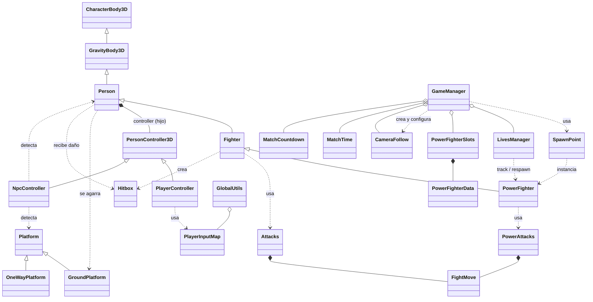

# UML — Arquitectura de código

> Mapa de clases del proyecto. Para la explicación de personajes ver `docs/arquitectura/arquitectura-personajes.md`.

## Personajes

```
CharacterBody3D → GravityBody3D → Person → Fighter → PowerFighter
Rol (nodo hijo): PersonController3D → PlayerController / NpcController
```

## Diagrama



## Notas

- `GravityBody3D`: gravedad 2D + colisiones (normales y entre cuerpos) + medidas del cuerpo.
- `Person`: moverse, saltar, ledge grab, plataformas one-way (drop-through y coyote time), daño, `respawn()`.
- `Fighter`: ataques (15 `FightMove`), grab (con `HitboxGrab` y lanzamiento), shield (con defensa y roll).
- `PowerFighter`: doble salto y ataques de poder (`PowerAttacks`); el "tercer salto" es el ataque de poder hacia arriba (`jump_power`).
- Rol por composición: `PersonController3D` (nodo hijo) → `PlayerController` (teclado) / `NpcController` (IA propia + `Area3D` de detección). Ver `docs/arquitectura/nota-power-fighter-controller.md`.
- `GameManager` es **modular**: un concern por módulo en `scripts/match/`, sin que un módulo le pregunte a otro. Ver `docs/arquitectura/nota-game-manager-modular.md`.
- `GameManager` es el **nodo raíz del mapa**: cada mapa lo trae junto con `PlayArea`, `SpawnPoint1..4` y los nodos `LivesManager`, `MatchTime` y `MatchCountdown`. Las vidas las maneja `LivesManager`; el manager reemite sus señales.
- `GameManager` tiene un `PowerFighterSlots` en memoria con un `PowerFighterData` por slot. `CharacterMenu` lo llena antes de cambiar de escena; no hay respaldo si está vacío. Ver `docs/arquitectura/nota-power-fighter-configurer.md`.
- El reloj vive en `MatchTime` y la cuenta inicial en `MatchCountdown`. `GameManager` los arranca, escucha sus señales y decide el fin de la partida. Ver `docs/arquitectura/nota-match-time.md` y `docs/arquitectura/nota-match-countdown.md`.
- A futuro el `GameManager` debería operar sobre `Person` (el papá) en vez de `PowerFighter`, para soportar más modos de juego.
- Señales-objeto: `VerticalForceSignals`, `MoveSignals`, `MoveStates`, `JumpSignals`, `MoveInput` (RefCounted en `scripts/helpers/frame`).
