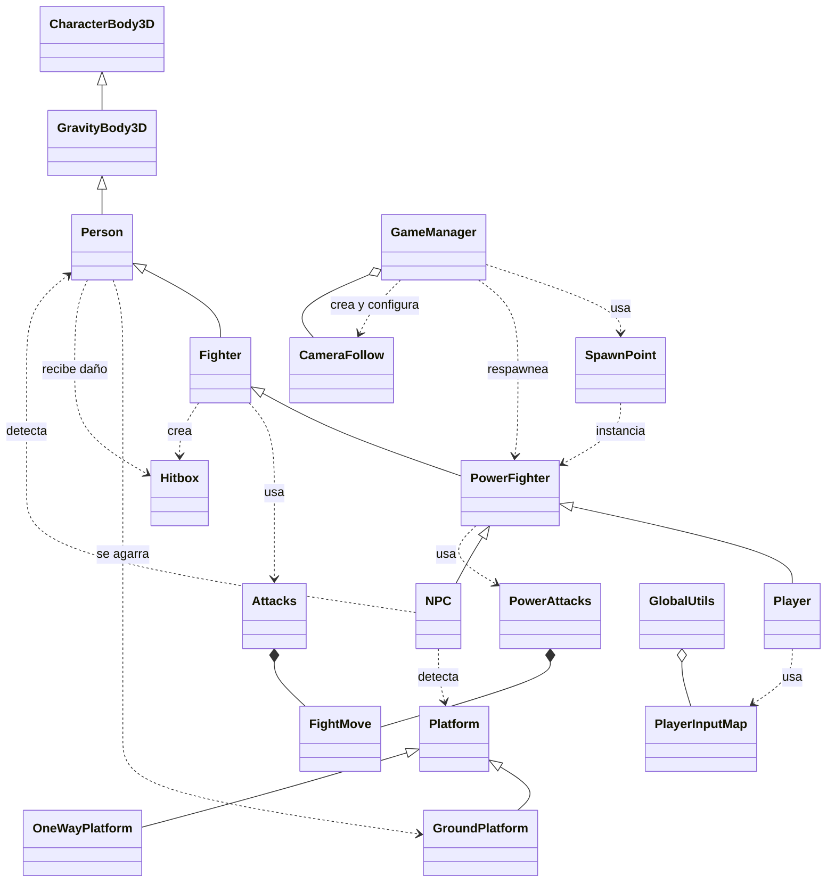

# UML — Arquitectura de código

> Mapa de clases del proyecto. Para la explicación de personajes ver `docs/arquitectura/arquitectura-personajes.md`.

## Personajes

```
CharacterBody3D → GravityBody3D → Person → Fighter → PowerFighter → Player / NPC
```

## Diagrama



## Notas

- `GravityBody3D`: gravedad 2D + colisiones (normales y entre cuerpos) + medidas del cuerpo.
- `Person`: moverse, saltar, ledge grab, plataformas one-way (drop-through y coyote time), daño, `respawn()`.
- `Fighter`: ataques (15 `FightMove`), grab (con `HitboxGrab` y lanzamiento), shield (con defensa y roll).
- `PowerFighter`: doble salto y ataques de poder (`PowerAttacks`); el "tercer salto" es el ataque de poder hacia arriba (`jump_power`).
- `NPC`: IA propia vía `_process_ai(delta, frame)` (hook definido en `Person`).
- `GameManager` es **modular**: un concern por módulo en `scripts/match/`, sin que un módulo le pregunte a otro. Ver `docs/arquitectura/nota-game-manager-modular.md`.
- Señales-objeto: `VerticalForceSignals`, `MoveSignals`, `MoveStates` (RefCounted en `scripts/helpers/frame`).
