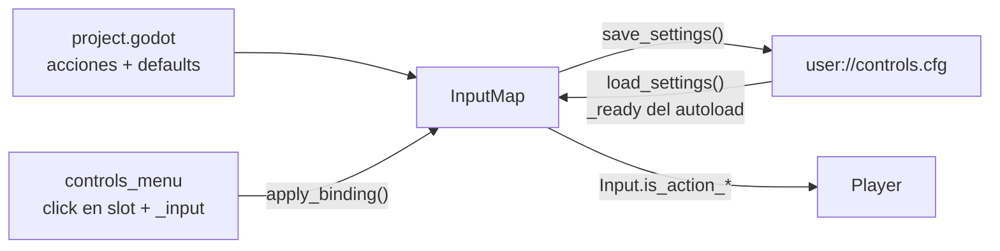

# Configurar controles (rebinding) — Godot Style

> Cómo funciona el menú que deja al jugador remapear sus controles, persistirlos y recargarlos al
> arrancar. Approach oficial de Godot: eventos + `InputMap` + `ConfigFile` en `user://`.

## La idea de fondo

**No usamos archivos de texto plano inventados.** Godot ya modela los controles con dos piezas:

- **`InputMap`**: un singleton global donde viven las *acciones* (ej. `player1_jump`) y sus eventos
  asociados (`InputEventKey`, `InputEventJoypadButton`, `InputEventJoypadMotion`). Las acciones se
  definen en `project.godot` y se cargan al abrir el juego.
- **`ConfigFile`**: un archivo estilo INI que Godot lee y escribe solo. Como los `InputEvent` son
  *Resources*, se serializan sin que hagamos nada: guardar la config del usuario es guardar los eventos
  tal cual.

Por qué NO tocar `project.godot` en runtime (`InputMap.save_to_project_settings()`): el proyecto
exportado es de solo lectura, así que ese método sirve solo para el editor. La config del jugador final
siempre vive en `user://controls.cfg`.

Los personajes NO cambian: `Player` lee con `Input.is_action_pressed(input_map.jump)` etc., y eso consulta
el `InputMap` en vivo. Por eso un rebind se siente al instante, sin cerrar el menú.

## Flujo

1. **Definir acciones + defaults** en `project.godot` (`player1_*` y `player2_*`, 10 acciones por
   jugador, 20 en total).
2. **Cargar** al arrancar: el autoload `InputSettings` (`_ready()` → `load_settings()`) lee el `.cfg` y,
   si existe, reescribe los eventos de cada acción sobre el `InputMap`. Corre antes de que spawneen los
   personajes.
3. **Capturar**: el jugador toca el botón del slot a remapear y `controls_menu.gd` escucha el siguiente
   evento válido en `_input()`. `Esc` cancela.
4. **Aplicar en vivo**: `apply_binding()` borra el evento viejo del mismo slot y agrega el nuevo.
5. **Guardar**: `save_settings()` serializa una "foto" completa de las 20 acciones.

## Decisiones de diseño

### Dos slots por acción, sin pisarse

Por arquitectura, una acción tiene como máximo **un bind por slot** (`InputSettings.Slot`):

- **`INPUT_MAP_1`**: PC. Teclado (`InputEventKey`); `matches_slot()` también reconoce
  `InputEventMouseButton`, pero la captura todavía no lo acepta.
- **`INPUT_MAP_2`**: gamepad. Botones (`InputEventJoypadButton`) y stick (`InputEventJoypadMotion`).

`apply_binding()` sustituye **solo** los eventos del slot al que pertenece el nuevo, así que teclado y
pad no se pisan entre sí.

### "Foto completa" y no solo lo que cambió

Se guardan **todas** las acciones en cada save. Así `load_settings()` no tiene que reconciliar nada: si
la acción está en el archivo, se sobreescribe (`action_erase_events` primero, para no acumular
duplicados); si no está, conserva el default de `project.godot`. Simple y determinista.

La lista de acciones sale de `GlobalUtils.PLAYER_INPUT_MAPS` (un `PlayerInputMap` por jugador), que es la
fuente de verdad. No hardcodear los nombres por fuera.

### Normalización al capturar (`normalize_captured_event()`)

- **Teclado**: solo `pressed` y sin `echo`; se fuerza `device = -1` (cualquier teclado). Ver
  "Peculiaridades".
- **Pad**: botón `pressed`; stick solo si `abs(axis_value) > 0.5`, y se normaliza con `signf()`. Una
  pulsada real del stick llega con cualquier valor entre -1 y 1, pero las acciones esperan ±1.0 por
  dirección.
- El `deadzone` es propiedad de la **acción**, no del evento: el menú no lo toca y `load_settings()`
  tampoco, así que se conserva el de `project.godot`.

## Archivos involucrados

| Archivo | Rol |
|---|---|
| `scripts/helpers/input/input_settings.gd` | Autoload `InputSettings` (registrado en `[autoload]` de `project.godot`). `load_settings()`, `save_settings()`, `exists_settings()`, y la lógica de captura: `matches_slot()`, `normalize_captured_event()`, `apply_binding()`, `get_bind_text()`. |
| `scripts/helpers/input/player_input_map.gd` | `PlayerInputMap` (`RefCounted`): los nombres de las 10 acciones de un jugador. |
| `scripts/helpers/global_utils.gd` | `PLAYER_INPUT_MAPS`: el `PlayerInputMap` de P1 y P2. |
| `scripts/ui/controls_menu.gd` + `ui/controls_menu.tscn` | La UI: un `TabContainer` con una pestaña por jugador y, por acción, una fila con dos botones (teclado / pad) que muestran `event.as_text()`. Los botones se crean por código desde `PLAYER_INPUT_MAPS`. |
| `scripts/ui/button_controls.gd` | Botón del menú principal que abre `res://ui/controls_menu.tscn`. |
| `user://controls.cfg` | Config del usuario. Fuera del repo y de la build. |

### Dónde queda `controls.cfg`

`user://` resuelve a una carpeta fuera del proyecto, según el `config/name` (`SuperSmashTux`):

| Sistema | Ruta de `user://` |
|---|---|
| **Linux** | `~/.local/share/godot/app_userdata/SuperSmashTux/` (o `$XDG_DATA_HOME/godot/...`) |
| **Windows** | `%APPDATA%\Godot\app_userdata\SuperSmashTux\` |
| **macOS** | `~/Library/Application Support/Godot/app_userdata/SuperSmashTux/` |

Para resetear a mano (fuera del juego), borra ese archivo.

## Peculiaridades

- **`device` del teclado en `project.godot`**: `player1_move_*` tienen `device: 0` en sus teclas (como
  si el teclado fuera el pad 0), mientras el resto usa `device: -1` (cualquier teclado). Por eso la
  captura fuerza `-1`.
- **Por qué la normalización no es cosmética**: una foto guardada con el teclado reportando otro device
  (se vio `device: 16` al guardar desde el editor) deja las acciones atadas a ese dispositivo y P1 deja
  de responder con *cualquier* teclado. Si tienes un `.cfg` contaminado, bórralo para volver a defaults.
- **`controls_menu._ready()` llama `save_settings()`** al abrir el menú: asegura que el `.cfg` exista,
  pero también guarda una foto del `InputMap` actual aunque no se haya cambiado nada (incluye los
  `device` tal como estén en ese momento).
- Los defaults de `walk`, `grab`, `shield` y `power_attack` solo traen teclado; el slot de pad arranca
  vacío y la UI muestra `None`.

## Estado de implementación

| Pieza | Estado |
|---|---|
| Autoload con carga/guardado en `user://controls.cfg` | Hecho |
| Menú con pestañas P1/P2, captura teclado y pad, `Esc` para cancelar | Hecho |
| Guardado automático al remapear | Hecho |
| Reset a defaults | **Pendiente**. No hay botón ni función. La receta es `InputMap.load_from_project_settings()` + `DirAccess.remove_absolute(SAVE_PATH)` (re-importa los defaults del proyecto, no hay que inventar el default por acción). |
| Captura de mouse (`INPUT_MAP_1`) | Pendiente (`matches_slot()` lo reconoce, `normalize_captured_event()` no) |
| Prohibir inputs repetidos | **Sin definir**. ¿Dos acciones con la misma tecla? ¿solo dentro del mismo jugador o también entre jugadores? Hoy no se valida nada. |
| Limitar el `device` del pad al del jugador | Sin definir. El evento de pad se guarda con el `device` real que lo generó. |

## Ver también

- [estructura.md](../estructura.md) — convenciones de carpetas; `scripts/helpers/` es para clases que NO
  son nodos (el autoload, que es un `Node` global, vive en `scripts/helpers/input/`).
- [Godot: InputMap](https://docs.godotengine.org/en/stable/classes/class_inputmap.html)
- [Godot: ConfigFile](https://docs.godotengine.org/en/stable/classes/class_configfile.html)
- [Godot: InputEvent](https://docs.godotengine.org/en/stable/classes/class_inputevent.html)
